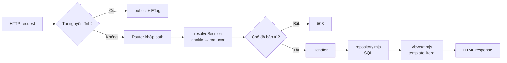

# CutTayShop

Nền tảng thương mại điện tử B2C hoàn chỉnh, viết **100% JavaScript thuần** trên Node.js và SQLite.
Không framework, không ORM, không bundler — **0 dependency ngoài**.

<p>
  
  
  
  
</p>

---

## Mục lục

- [Tính năng](#tính-năng)
- [Khởi chạy nhanh](#khởi-chạy-nhanh)
- [Tài khoản demo](#tài-khoản-demo)
- [Kiến trúc](#kiến-trúc)
- [Cơ sở dữ liệu](#cơ-sở-dữ-liệu)
- [Cổng quản trị](#cổng-quản-trị)
- [API](#api)
- [Kiểm thử](#kiểm-thử)
- [Bảo mật](#bảo-mật)
- [Ghi chú kỹ thuật](#ghi-chú-kỹ-thuật)

---

## Tính năng

### Storefront
- **Trang chủ** — hero editorial nhiều lớp, 10 danh mục pastel, flash sale đếm ngược, sản phẩm nổi bật, hàng mới về
- **Catalog (PLP)** — lọc theo danh mục / thương hiệu / khoảng giá / đánh giá / tồn kho / giảm giá, 5 kiểu sắp xếp, phân trang
- **Chi tiết sản phẩm (PDP)** — gallery nhiều ảnh, biến thể, thông số kỹ thuật, đánh giá, sản phẩm liên quan
- **Tìm kiếm không dấu** — `"tai nghe"` khớp `"Tai nghe chụp tai..."`, dropdown gợi ý trực tiếp
- **Giỏ hàng bền vững** — lưu trong SQLite, gộp giỏ khách vào tài khoản khi đăng nhập
- **Thanh toán** — COD / VietQR, phí ship theo phương thức, trừ tồn kho tự động
- **Tra cứu vận đơn** — timeline tiến trình giao hàng
- **Yêu thích, so sánh, blog, 11 trang chính sách**

### Cổng khách hàng
Bảng điều khiển, hồ sơ, sổ địa chỉ, lịch sử đơn, chi tiết đơn, hội viên CutTayShop+, ví voucher, đổi mật khẩu, đánh giá sản phẩm.

### Cổng quản trị
CRUD đầy đủ cho sản phẩm, danh mục, đơn hàng, tồn kho, voucher, banner, blog, đánh giá, khách hàng, phân quyền, cài đặt — kèm nhật ký thao tác.

### Giao diện
- Design system với CSS custom properties, **dark mode** đầy đủ
- Mobile-first: bottom navigation, filter drawer, sticky bar
- 89 ảnh WebP/SVG chất lượng studio
- WCAG 2.2 AA: vùng chạm ≥ 44px, tương phản màu đạt chuẩn

---

## Khởi chạy nhanh

**Yêu cầu:** Node.js ≥ 22.5 (dùng module built-in `node:sqlite`)

```bash
git clone https://github.com/leduwn/CutTayShop.git
cd CutTayShop
node server.mjs
```

Mở http://localhost:5139

Đổi cổng: `PORT=3000 node server.mjs`

Lần chạy đầu tự tạo `data/cuttayshop.db` và nạp dữ liệu mẫu (32 sản phẩm, 10 danh mục, 3 bài blog, 4 voucher, 3 đơn hàng).

### Các lệnh khác

```bash
npm run dev          # chạy với --watch (tự khởi động lại khi sửa)
npm run verify       # 127 kiểm thử: routes + API + phân quyền + assets
npm run db:reset     # xoá database, nạp lại dữ liệu mẫu
npm run check:svg    # kiểm tra tính hợp lệ XML của các file SVG
```

---

## Tài khoản demo

| Vai trò | Email | Mật khẩu | Truy cập |
|---|---|---|---|
| Quản trị viên | `admin@cuttayshop.vn` | `admin123456` | `/admin` |
| Khách hàng | `nguyenvanan@gmail.com` | `demo123456` | `/tai-khoan` |

Mật khẩu băm bằng **scrypt**, phiên lưu bảng `sessions` với cookie `HttpOnly`.

### Bản đồ URL

| Trang | URL |
|---|---|
| Trang chủ | `/` |
| Catalog | `/san-pham` |
| Danh mục | `/danh-muc/cong-nghe` |
| Chi tiết sản phẩm | `/san-pham/tai-nghe-chup-tai-studio-pro-wireless` |
| Tìm kiếm | `/tim-kiem?q=tai+nghe` |
| Flash sale | `/flash-sale` |
| Khuyến mãi | `/khuyen-mai` |
| Giỏ hàng | `/gio-hang` |
| Thanh toán | `/thanh-toan` |
| Tra cứu vận đơn | `/tra-cuu-don-hang` |
| Blog | `/blog` |
| Tài khoản | `/tai-khoan` |
| Quản trị | `/admin` |

---

## Kiến trúc

```
CutTayShop/
├── server.mjs                  # HTTP server, middleware phiên, chế độ bảo trì
├── package.json
├── data/
│   ├── seed.json               # Dữ liệu mẫu (JSON)
│   └── cuttayshop.db           # SQLite (tự sinh, không commit)
├── public/                     # Tài nguyên tĩnh
│   ├── css/                    # design-system, tokens-compat, homepage, catalog, admin
│   ├── js/                     # cart-api, catalog, store-interactions, theme-toggle
│   └── images/                 # 89 ảnh WebP/SVG
├── src/
│   ├── db.mjs                  # Schema, migration, nạp seed
│   ├── repository.mjs          # Toàn bộ truy vấn SQL + CRUD
│   ├── auth.mjs                # scrypt hash, session token, cookie
│   ├── format.mjs              # Định dạng số/ngày, bỏ dấu tiếng Việt
│   ├── http/
│   │   ├── router.mjs          # Router tối giản (:param, :param?)
│   │   ├── session.mjs         # Middleware phiên + khoá giỏ khách
│   │   ├── static.mjs          # File tĩnh (ETag + 304)
│   │   └── utils.mjs           # Parse query/form, gửi response
│   ├── routes/
│   │   ├── storefront.mjs      # Trang chủ, catalog, PDP, giỏ hàng, blog
│   │   ├── account.mjs         # Tài khoản + đăng nhập/đăng ký
│   │   ├── admin.mjs           # Quản trị CRUD (guard admin)
│   │   └── api.mjs             # API JSON
│   └── views/                  # Template literal thay cho template engine
│       ├── partials.mjs        # Layout, header, footer, product card
│       ├── home.mjs
│       ├── catalog.mjs
│       ├── shop.mjs            # Giỏ hàng, thanh toán, khuyến mãi
│       ├── account.mjs
│       ├── content.mjs         # Blog + trang chính sách
│       ├── admin.mjs           # 22 trang quản trị
│       └── errors.mjs
└── tools/
    ├── extract-seed.mjs        # Sinh data/seed.json
    ├── verify-routes.mjs       # Kiểm thử hồi quy
    ├── reset-db.mjs
    └── check-svg.mjs
```

### Luồng request



---

## Cơ sở dữ liệu

**23 bảng**, quan hệ đầy đủ với `FOREIGN KEY ... ON DELETE CASCADE`.

| Nhóm | Bảng |
|---|---|
| Danh mục | `categories`, `products`, `product_images`, `product_specs`, `product_variants`, `product_reviews`, `product_related` |
| Nội dung | `blog_posts`, `blog_tags`, `blog_related_products`, `promo_banners`, `trust_benefits` |
| Bán hàng | `orders`, `order_items`, `order_tracking_steps`, `coupons` |
| Người dùng | `users`, `sessions`, `addresses` |
| Tương tác | `carts`, `cart_items`, `wishlist`, `contact_messages` |
| Hệ thống | `settings`, `audit_log` |

### Ghi dữ liệu thật

| Thao tác | Bảng bị ảnh hưởng |
|---|---|
| Đăng ký / đăng nhập | `users`, `sessions` |
| Thêm giỏ hàng | `carts`, `cart_items` |
| Đặt hàng | `orders`, `order_items`, `order_tracking_steps`, trừ `products.total_stock` |
| Yêu thích | `wishlist` |
| Đánh giá | `product_reviews` (chờ duyệt) → tính lại `products.rating` |
| Liên hệ | `contact_messages` |
| Thao tác admin | `audit_log` |

### Migration tự động

`COLUMN_MIGRATIONS` trong `src/db.mjs` kiểm tra `PRAGMA table_info` và thêm cột còn thiếu.
Database tạo từ phiên bản trước vẫn nâng cấp được mà không mất dữ liệu.

---

## Cổng quản trị

Mọi route `/admin/*` đều qua `guard()` — yêu cầu `role = 'admin'`.

| Chức năng | Thao tác |
|---|---|
| Sản phẩm | Thêm, sửa, xoá, lọc theo ngành hàng / từ khoá |
| Danh mục | Thêm, sửa, xoá (chặn xoá nếu còn sản phẩm) |
| Đơn hàng | Đổi trạng thái (ghi thêm bước vận đơn), lưu mã vận đơn, in phiếu |
| Tồn kho | Nhập thêm số lượng trực tiếp |
| Voucher | Tạo, sửa, xoá |
| Banner CMS | Thêm, sửa, xoá |
| Blog | Đăng bài, sửa, xoá |
| Đánh giá | Duyệt / ẩn / xoá (tự tính lại điểm sản phẩm) |
| Khách hàng | Xem hồ sơ, khoá / mở tài khoản |
| Phân quyền | Đổi vai trò customer ↔ admin |
| Hỗ trợ | Đánh dấu đã xử lý / mở lại |
| Cài đặt | Hotline, phí ship, ngưỡng freeship, **chế độ bảo trì** |
| Nhật ký | 200 thao tác gần nhất |

**Chế độ bảo trì:** bật trong Cài đặt → storefront trả 503, admin vẫn truy cập được.

---

## API

| Method | Endpoint | Mô tả |
|---|---|---|
| `GET` | `/api/v1/search/quick?q=` | Gợi ý tìm kiếm (6 kết quả) |
| `GET` | `/Home/SearchSuggestions?q=` | Gợi ý tìm kiếm (5 kết quả) |
| `GET` | `/api/v1/cart` | Giỏ hàng hiện tại |
| `POST` | `/api/v1/cart/add` | Thêm sản phẩm `{productId, quantity, variantId?}` |
| `POST` | `/api/v1/cart/update` | Đổi số lượng `{itemId, quantity}` |
| `POST` | `/api/v1/cart/remove` | Xoá dòng `{itemId}` |
| `POST` | `/api/v1/cart/apply-coupon` | Áp voucher `{code}` |
| `GET` | `/api/v1/wishlist` | Danh sách yêu thích |
| `POST` | `/api/v1/wishlist/toggle` | Bật/tắt yêu thích `{productId}` |
| `POST` | `/api/v1/reviews` | Gửi đánh giá `{productId, rating, comment}` |
| `POST` | `/api/v1/ai/chat` | Trợ lý CutTay AI `{message}` |

API yêu cầu đăng nhập trả `401` kèm `{ requiresLogin: true }`.

---

## Kiểm thử

```bash
npm run verify
```

```
KẾT QUẢ: 127 đạt / 0 lỗi / 127 tổng
```

Bộ kiểm thử bao gồm:

- **47 route công khai** — storefront, blog, chính sách, trang lỗi
- **9 route khách hàng** — yêu cầu đăng nhập
- **43 route quản trị** — yêu cầu quyền admin (gồm alias VN + EN)
- **3 test phân quyền** — chưa đăng nhập → 302, khách thường → 403, sai mật khẩu → 401
- **11 test API** — giỏ hàng, voucher, wishlist, tìm kiếm, AI
- **14 tài nguyên tĩnh** — CSS, JS, ảnh

Script tự đăng nhập bằng tài khoản demo để kiểm tra cổng được bảo vệ.

---

## Bảo mật

Đây là ứng dụng demo (không thanh toán thật), nhưng phần xác thực là thật:

- Mật khẩu băm **scrypt** với salt ngẫu nhiên 16 byte
- So sánh bằng `timingSafeEqual` (chống timing attack)
- Cookie phiên `HttpOnly` + `SameSite=Lax`, hạn 7 ngày
- Phiên hết hạn được dọn tự động mỗi lần đăng nhập
- Mọi giá trị chèn vào HTML đều qua `esc()`
- Chặn path traversal khi phục vụ file tĩnh

> **Lưu ý:** `contentHtml` của blog và `iconSvg` được render thô (không escape) vì là nội dung do admin nhập. Trong môi trường production thật cần sanitize hoặc dùng CSP.

---

## Ghi chú kỹ thuật

**Tìm kiếm không dấu.** Mỗi sản phẩm có cột `search_text` lưu sẵn
`name + category + shortDescription + brand` đã bỏ dấu và viết thường.
Truy vấn dùng `LIKE '%...%'` nên `"tai nghe"` khớp `"Tai nghe chụp tai..."`.

**Định dạng số.** Dùng `Intl.NumberFormat('en-US')` để khớp `ToString("N0")`
của .NET (`1,490,000`), không phải `vi-VN` (`1.490.000`).

**Lớp token tương thích.** `public/css/tokens-compat.css` ánh xạ các biến CSS
mà `admin-portal.css` / `storefront-pages.css` dùng nhưng `design-system.css`
chưa khai báo (`--color-bg-primary`, `--color-border`, `--color-warning`...).
Thiếu lớp này, dark mode sẽ cho chữ trắng trên nền trắng.

**Giỏ hàng phía client.** `public/js/cart-api.js` gọi API thật
(`/api/v1/cart/*`) thay vì `localStorage`.

**Không phụ thuộc thư viện.** Router, template engine, session, hash mật khẩu,
phục vụ file tĩnh — tất cả viết tay bằng module built-in của Node.js.

---

## Giấy phép

MIT
