# CUTTAYSHOP — SITEMAP & ASP.NET CORE ROUTING MATRIX

**Mã tài liệu:** CTS-DOC-002  
**Phiên bản:** 1.0.0  
**Tác giả:** Agent C (E-commerce Product Designer & Information Architect)  
**Kiến trúc:** ASP.NET Core 10 MVC (Attribute Routing & Area Routing)  
**Trạng thái:** Đặc tả Phase 0 — nguồn sự thật canonical cho URL/controller/phase  

---

## 1. TỔNG QUAN KIẾN TRÚC ĐỊNH TUYẾN (ROUTING ARCHITECTURE)

Hệ thống CutTayShop áp dụng chuẩn định tuyến hiện đại của ASP.NET Core MVC:
1. **Storefront (Khách hàng & Vãng lai):** Sử dụng Attribute Routing kết hợp Slug thân thiện SEO tiếng Việt không dấu, có tiền tố rõ ràng.
2. **Customer Account:** Định tuyến phân nhóm tiền tố `/tai-khoan/...` bảo vệ bởi `[Authorize]`.
3. **Admin Area:** Sử dụng ASP.NET Core MVC Area `[Area("Admin")]` với tiền tố `/admin/...`, xác thực mặc định và policy theo capability (`ManageCatalog`, `ManageOrders`, `ManageContent`, `ManageCustomers`, `ManagePromotions`, `ManageSettings`, `ViewReports`).
4. **API Endpoints phục vụ AJAX / Mini-cart / CutTay AI:** Tiền tố `/api/v1/...` trả về định dạng JSON thuần.

---

## 2. SƠ ĐỒ CÂY ĐIỀU HƯỚNG (MERMAID SITEMAP)

```mermaid
graph TD
    Root([CutTayShop Root])

    %% PUBLIC STOREFRONT
    Root --> Storefront[1. Public Storefront]
    Storefront --> Home[Trang chủ /]
    Storefront --> Catalog[Danh mục sản phẩm /san-pham]
    Catalog --> CategoryDetail[Chi tiết danh mục /danh-muc/:slug]
    Catalog --> ProductDetail[Chi tiết sản phẩm /san-pham/:slug]
    Storefront --> Search[Tìm kiếm /tim-kiem]
    Storefront --> FlashSale[Deal Hot / Flash Sale /flash-sale]
    Storefront --> Wishlist[Yêu thích /yeu-thich]
    Storefront --> Compare[So sánh /so-sanh]
    Storefront --> Cart[Giỏ hàng /gio-hang]
    Storefront --> Checkout[Thanh toán /thanh-toan]
    Storefront --> OrderSuccess[Xác nhận đơn /dat-hang-thanh-cong]
    Storefront --> OrderTracking[Tra cứu đơn /tra-cuu-don-hang]
    Storefront --> BlogGroup[Kênh nội dung & Blog]
    BlogGroup --> BlogList[Danh sách tin /blog]
    BlogGroup --> BlogDetail[Chi tiết bài viết /blog/:slug]
    Storefront --> StaticGroup[Thông tin & Chính sách]
    StaticGroup --> About[Về chúng tôi /ve-chung-toi]
    StaticGroup --> Contact[Liên hệ /lien-he]
    StaticGroup --> FAQ[Câu hỏi thường gặp /faq]
    StaticGroup --> PolicyReturn[Chính sách đổi trả /chinh-sach/doi-tra]
    StaticGroup --> PolicyShipping[Chính sách giao hàng /chinh-sach/giao-hang]
    StaticGroup --> PolicyPrivacy[Chính sách bảo mật /chinh-sach/bao-mat]
    StaticGroup --> PolicyTerms[Điều khoản dịch vụ /chinh-sach/dieu-khoan]

    %% CUSTOMER ACCOUNT
    Root --> Account[2. Customer Account /tai-khoan]
    Account --> AuthGroup[Xác thực]
    AuthGroup --> Login[Đăng nhập /dang-nhap]
    AuthGroup --> Register[Đăng ký /dang-ky]
    AuthGroup --> ForgotPass[Quên mật khẩu /quen-mat-khau]
    AuthGroup --> ResetPass[Đặt lại mật khẩu /dat-lai-mat-khau]
    Account --> Profile[Thông tin cá nhân /tai-khoan/ho-so]
    Account --> Addresses[Sổ địa chỉ /tai-khoan/dia-chi]
    Account --> Orders[Lịch sử đơn hàng /tai-khoan/don-hang]
    Orders --> OrderDetailCustomer[Chi tiết đơn hàng /tai-khoan/don-hang/:code]
    Account --> Loyalty[Hội viên CutTayShop+ /tai-khoan/cuttayshop-plus]
    Account --> Vouchers[Ví Voucher của tôi /tai-khoan/ma-giam-gia]
    Account --> ChangePass[Đổi mật khẩu /tai-khoan/doi-mat-khau]

    %% ADMIN AREA
    Root --> Admin[3. Admin Portal /admin]
    Admin --> AdminDashboard[Dashboard Thống kê /admin]
    Admin --> AdminProducts[Quản lý Sản phẩm /admin/san-pham]
    AdminProducts --> AdminProductCreate[Thêm mới SP /admin/san-pham/them-moi]
    AdminProducts --> AdminProductEdit[Sửa SP /admin/san-pham/chinh-sua/:id]
    Admin --> AdminCategories[Quản lý Danh mục /admin/danh-muc]
    Admin --> AdminInventory[Quản lý Kho & Tồn /admin/ton-kho]
    Admin --> AdminOrders[Quản lý Đơn hàng /admin/don-hang]
    AdminOrders --> AdminOrderDetail[Xử lý Đơn /admin/don-hang/chi-tiet/:id]
    Admin --> AdminCustomers[Quản lý Khách hàng /admin/khach-hang]
    Admin --> AdminPromotions[Chiến dịch & Voucher /admin/khuyen-mai]
    Admin --> AdminBanners[Quản lý Banner CMS /admin/banner-cms]
    Admin --> AdminReviews[Kiểm duyệt Đánh giá /admin/danh-gia]
    Admin --> AdminBlog[Quản lý Bài viết /admin/bai-viet]
    Admin --> AdminReports[Báo cáo Doanh thu /admin/bao-cao]
    Admin --> AdminSettings[Cấu hình Hệ thống /admin/cai-dat]

    %% SYSTEM PAGES
    Root --> System[4. System Pages]
    System --> Error404[404 Không tìm thấy /404]
    System --> Error403[403 Từ chối truy cập /403]
    System --> Error500[500 Lỗi máy chủ /500]
    System --> SessionExpired[Hết phiên làm việc /session-expired]
    System --> Maintenance[Bảo trì hệ thống /bao-tri]
```



---

## 3. DANH MỤC 50+ TRANG HỆ THỐNG (CATEGORIZED DIRECTORY)

### Nhóm 1: Public Storefront (Khách mua hàng & Vãng lai)
1. **Trang chủ (Homepage):** Điểm chạm chính, Hero bento grid, danh mục nổi bật, deal hot flash sale, CutTay AI.
2. **Danh mục tổng hợp (Catalog / All Products):** Lưới sản phẩm, thanh lọc bộ lọc đa tiêu chí bên trái, sắp xếp.
3. **Danh mục theo ngành hàng (Category Listing):** Hiển thị sản phẩm theo phân cấp danh mục, mô tả banner SEO.
4. **Chi tiết sản phẩm (Product Detail Page - PDP):** Bộ ảnh thư viện, chọn biến thể, giá flash sale, nút mua, review, đánh giá, sp liên quan.
5. **Tìm kiếm sản phẩm (Search Results):** Trang kết quả tìm kiếm theo từ khóa kèm bộ lọc.
6. **Flash Sale / Deal Hot (Campaign Landing):** Trang chiến dịch khuyến mãi theo khung giờ đếm ngược.
7. **Danh sách Yêu thích (Wishlist):** Lưu sản phẩm khách hàng quan tâm.
8. **So sánh sản phẩm (Product Comparison):** Bảng so sánh 2-4 sản phẩm về giá, thông số, bảo hành.
9. **Giỏ hàng (Cart Page):** Danh sách hàng trong giỏ, cập nhật số lượng, xóa, nhập voucher tạm tính.
10. **Thanh toán (Checkout Page):** One-page checkout điền địa chỉ, chọn vận chuyển, thanh toán COD/QR.
11. **Xác nhận đặt hàng thành công (Order Success):** Cảm ơn, mã đơn/receipt và link tra cứu; QR chỉ xuất hiện khi VietQR được triển khai ở Phase 2.
12. **Tra cứu đơn hàng không đăng nhập (Order Lookup):** Form nhập mã đơn + số điện thoại để xem hành trình.
13. **Kết quả tra cứu đơn (Order Tracking Detail):** Dòng thời gian tiến độ giao nhận của đơn hàng.
14. **Trang chủ Blog / Tin tức (Blog Index):** Danh sách bài viết xu hướng, cẩm nang công nghệ & phong cách sống.
15. **Chi tiết bài viết Blog (Blog Post Detail):** Nội dung bài viết kèm khối sản phẩm gợi ý mua ngay.
16. **Danh mục Blog (Blog Category):** Lọc bài viết theo chủ đề (Công nghệ, Thời trang, Cuộc sống).
17. **Về chúng tôi (About Us):** Câu chuyện thương hiệu CutTayShop, cam kết 100% chính hãng, đội ngũ.
18. **Liên hệ & Hỗ trợ (Contact Us):** Biểu mẫu gửi phản hồi, thông tin văn phòng, bản đồ, hotline.
19. **Câu hỏi thường gặp (FAQ):** Hướng dẫn mua hàng, thời gian ship, chính sách tích điểm CutTayShop+.
20. **Chính sách đổi trả hàng 7 ngày (Return Policy):** Quy chuẩn đổi trả hàng nguyên tem mác.
21. **Chính sách giao hàng & Cước phí (Shipping Policy):** Bảng giá ship theo tỉnh thành và điều kiện freeship.
22. **Chính sách bảo mật thông tin (Privacy Policy):** Cam kết bảo vệ dữ liệu người dùng.
23. **Điều khoản sử dụng dịch vụ (Terms of Service):** Quy chế sàn thương mại điện tử.
24. **Sản phẩm khuyến mãi (Promotion Products):** Danh sách promotion đang hoạt động ngoài Flash Sale, route `/khuyen-mai` (MVP).

### Nhóm 2: Customer Account Portal (Khu vực tài khoản khách hàng)
25. **Đăng nhập (Sign In):** Form đăng nhập email/mật khẩu, nút Google 1-Click.
26. **Đăng ký (Sign Up):** Form tạo tài khoản thành viên mới nhận voucher chào mừng 20k.
27. **Quên mật khẩu (Forgot Password):** Gửi email chứa liên kết đặt lại mật khẩu an toàn.
28. **Đặt lại mật khẩu (Reset Password):** Form nhập mật khẩu mới qua token xác thực.
29. **Tổng quan tài khoản (Account Dashboard):** Thống kê số đơn hàng, điểm CutTayShop+, quyền lợi thành viên.
30. **Hồ sơ cá nhân (Account Profile):** Xem và cập nhật họ tên, số điện thoại, ngày sinh, ảnh đại diện.
31. **Sổ địa chỉ nhận hàng (Address Book):** Danh sách địa chỉ đã lưu, đánh dấu địa chỉ mặc định.
32. **Thêm mới / Chỉnh sửa địa chỉ (Address Form Modal/Page):** Chọn Tỉnh -> Huyện -> Xã qua AJAX.
33. **Đơn hàng của tôi (My Orders):** Tab phân loại: Tất cả, Chờ xác nhận, Đang xử lý, Đang giao, Đã giao, Đã hủy.
34. **Chi tiết đơn hàng khách hàng (Customer Order Detail):** Tiến trình vận chuyển, thông tin kiện hàng, nút hủy đơn nếu còn mới, nút mua lại.
35. **Đặc quyền thành viên CutTayShop+ (Loyalty Hub):** Hạng thành viên hiện tại, thanh tiến độ lên hạng, lịch sử tích và tiêu điểm.
36. **Ví mã giảm giá (My Vouchers):** Danh sách voucher sẵn có trong ví, mã freeship hàng tháng của hạng thành viên.
37. **Đổi mật khẩu tài khoản (Change Password):** Cập nhật mật khẩu định kỳ để nâng cao bảo mật.
38. **Xác minh email (Verify Email):** Kết quả xác minh token, resend có rate limit (MVP).
39. **Quản lý đánh giá của tôi (My Reviews):** Sản phẩm đủ điều kiện/chờ duyệt/đã đăng (Phase 2).

### Nhóm 3: Admin Management Area (Khu vực quản trị nghiệp vụ)
40. **Bảng điều khiển tổng quan (Admin Dashboard):** KPI doanh thu ngày/tuần/tháng, số đơn mới, số khách mới, biểu đồ xu hướng.
41. **Danh sách sản phẩm (Admin Product List):** Bảng dữ liệu sản phẩm, tìm kiếm, lọc theo ngành hàng, trạng thái ẩn/hiện, tồn kho.
42. **Thêm mới sản phẩm (Admin Create Product):** Form nhập thông tin cơ bản, SEO slug, upload nhiều ảnh, cấu hình bảng biến thể SKU (Màu/Size/Giá/Kho).
43. **Chỉnh sửa sản phẩm (Admin Edit Product):** Cập nhật nội dung, giá sale, quản lý SKU từng biến thể.
44. **Quản lý danh mục (Admin Category Management):** Cây danh mục cha-con, kéo thả thứ tự hiển thị, upload icon danh mục.
45. **Quản lý tồn kho & Nhập hàng (Admin Inventory Hub):** Cảnh báo sắp hết hàng (< 5 món), điều chỉnh tồn kho tức thì.
46. **Danh sách đơn hàng (Admin Order List):** Bảng quản lý đơn hàng với bộ lọc trạng thái, tìm theo mã đơn/SĐT/ngày.
47. **Xử lý & Cập nhật đơn hàng (Admin Order Processing):** Đổi trạng thái (Xác nhận -> Đóng gói -> Giao cho shipper), in phiếu đóng gói (Packing Slip).
48. **Quản lý khách hàng (Admin Customer List):** Danh sách người dùng, xem tổng chi tiêu, số đơn đã mua, hạng CutTayShop+, khóa tài khoản gian lận.
49. **Chi tiết khách hàng (Admin Customer Detail):** Lịch sử mua sắm, địa chỉ nhận hàng, lịch sử điểm thưởng.
50. **Quản lý khuyến mãi & Mã Coupon (Admin Coupon Management):** Tạo mã giảm giá %, giảm tiền mặt, cấu hình min order, ngày hết hạn.
51. **Quản lý Flash Sale (Admin Flash Sale Setup):** Cài đặt khung giờ flash sale, thêm sản phẩm tham gia sale và giá ưu đãi đặc biệt.
52. **Quản lý Banner & Quảng cáo CMS (Admin Banner CMS):** Cập nhật banner Hero slider, banner phụ bên phải, banner pop-up.
53. **Kiểm duyệt Đánh giá sản phẩm (Admin Review Moderation):** Duyệt/ẩn các bài đánh giá thô tục, spam, trả lời phản hồi khách.
54. **Quản trị Blog & Tin tức (Admin Blog Management):** Danh sách bài viết, tạo mới/sửa bài với trình soạn thảo WYSIWYG, gán sản phẩm liên kết.
55. **Báo cáo & Thống kê kinh doanh (Admin Financial & Sales Reports):** Doanh số theo ngành hàng, tỷ lệ chuyển đổi, top 10 sản phẩm bán chạy nhất.
56. **Cài đặt hệ thống (Admin System Settings):** Thông tin cửa hàng, hotline, phí ship mặc định, ngưỡng miễn phí vận chuyển.
57. **Quản lý biến thể sản phẩm (Admin Variants):** SKU, giá chênh lệch, thuộc tính; tồn kho nằm ở Inventory Hub (Phase 2).
58. **Hỗ trợ khách hàng (Admin Support):** Ticket/contact queue, assignment và trạng thái (Phase 2).
59. **Người dùng & phân quyền (Admin Roles):** Gán role/capability, audit thay đổi quyền (Future).

### Nhóm 4: System, Operational & Error Pages
60. **Lỗi 404 Không tìm thấy (Page Not Found):** Giao diện thân thiện phong cách sticker vui nhộn kèm gợi ý các trang mua sắm hot.
61. **Lỗi 403 Không có quyền (Forbidden / Access Denied):** Cảnh báo khi người dùng không đủ quyền truy cập Admin Area.
62. **Lỗi 500 Lỗi máy chủ (Internal Server Error):** Thông báo lịch sự hệ thống đang khắc phục kèm nút quay lại trang chủ.
63. **Hết phiên làm việc (Session Expired):** Thông báo khi giỏ hàng hoặc phiên đăng nhập hết hạn.
64. **Bảo trì hệ thống (Maintenance Mode):** Trang thông báo bảo trì nâng cấp hạ tầng định kỳ.

### Trạng thái hệ thống dùng chung (không tạo route riêng)

| State | Trang sở hữu | Phase | Yêu cầu phục hồi |
| :--- | :--- | :--- | :--- |
| Loading/Skeleton | Home, PLP, PDP, Account, Admin | MVP | Giữ layout, reduced-motion, không công bố dữ liệu giả |
| Empty | Cart, Wishlist, Orders, Admin lists | MVP | Giải thích + CTA hợp lý |
| No search results | Search/PLP | MVP | Giữ query/filter + xóa lọc |
| Out of stock | PDP/ProductCard/Cart | MVP | Disable mua + gợi ý thay thế/nhận thông báo |
| Inline/partial error | Mọi page có request phụ | MVP | Retry idempotent, không phá toàn trang |
| Session expired | Auth/Checkout/Admin | MVP | Giữ dữ liệu form an toàn khi có thể và đưa về đăng nhập |

---

## 4. MA TRẬN ROUTE ASP.NET CORE MVC (COMPREHENSIVE ROUTE MATRIX)

| Mã | Tên trang / Nghiệp vụ | URL Pattern | HttpMethod | Controller | Action | Area | Phân quyền (Auth) | View Template Path | Giai đoạn |
|---|---|---|---|---|---|---|---|---|---|
| **P-01** | Trang chủ | `/` | GET | `HomeController` | `Index` | Storefront | Anonymous | `Views/Home/Index.cshtml` | MVP |
| **P-02** | Toàn bộ sản phẩm | `/san-pham` | GET | `CatalogController` | `Index` | Storefront | Anonymous | `Views/Catalog/Index.cshtml` | MVP |
| **P-03** | Danh mục ngành hàng | `/danh-muc/{slug}` | GET | `CatalogController` | `Category` | Storefront | Anonymous | `Views/Catalog/Category.cshtml` | MVP |
| **P-04** | Chi tiết sản phẩm | `/san-pham/{slug}` | GET | `CatalogController` | `Detail` | Storefront | Anonymous | `Views/Catalog/Detail.cshtml` | MVP |
| **P-05** | Tìm kiếm sản phẩm | `/tim-kiem` | GET | `CatalogController` | `Search` | Storefront | Anonymous | `Views/Catalog/Search.cshtml` | MVP |
| **P-06** | Tìm kiếm nhanh (API) | `/api/v1/search/quick` | GET | `SearchApiController` | `QuickSearch` | API | Anonymous | JSON Response | MVP |
| **P-07** | Chiến dịch Flash Sale | `/flash-sale` | GET | `PromotionController` | `FlashSale` | Storefront | Anonymous | `Views/Promotion/FlashSale.cshtml` | MVP |
| **P-08** | Danh sách yêu thích | `/yeu-thich` | GET | `WishlistController` | `Index` | Storefront | Anonymous / Customer | `Views/Wishlist/Index.cshtml` | MVP |
| **P-09** | Thêm/Xóa yêu thích (API)| `/api/v1/wishlist/toggle`| POST | `WishlistApiController`| `Toggle` | API | Anonymous / Customer | JSON Response | MVP |
| **P-10** | So sánh sản phẩm | `/so-sanh` | GET | `CompareController` | `Index` | Storefront | Anonymous | `Views/Compare/Index.cshtml` | Future |
| **P-11** | Giỏ hàng | `/gio-hang` | GET | `CartController` | `Index` | Storefront | Anonymous | `Views/Cart/Index.cshtml` | MVP |
| **P-12** | Thêm vào giỏ (API) | `/api/v1/cart/add` | POST | `CartApiController` | `AddToCart` | API | Anonymous | JSON Response | MVP |
| **P-13** | Cập nhật giỏ (API) | `/api/v1/cart/update` | POST | `CartApiController` | `UpdateCart`| API | Anonymous | JSON Response | MVP |
| **P-14** | Xóa khỏi giỏ (API) | `/api/v1/cart/remove` | POST | `CartApiController` | `RemoveItem`| API | Anonymous | JSON Response | MVP |
| **P-15** | Kiểm tra Voucher (API) | `/api/v1/cart/apply-coupon`| POST | `CartApiController`| `ApplyCoupon`| API | Anonymous | JSON Response | MVP |
| **P-16** | Trang Thanh toán | `/thanh-toan` | GET | `CheckoutController` | `Index` | Storefront | Anonymous / Customer | `Views/Checkout/Index.cshtml` | MVP |
| **P-17** | Xử lý Đặt hàng | `/thanh-toan` | POST | `CheckoutController` | `ProcessOrder` | Storefront | Anonymous / Customer | Redirect / View | MVP |
| **P-18** | Đặt hàng thành công | `/dat-hang-thanh-cong` | GET | `CheckoutController` | `OrderSuccess`| Storefront | Anonymous | `Views/Checkout/Success.cshtml`| MVP |
| **P-19** | Tra cứu đơn hàng | `/tra-cuu-don-hang` | GET, POST | `OrderController` | `Tracking` | Storefront | Anonymous | `Views/Order/Tracking.cshtml` | MVP |
| **P-20** | Tin tức / Blog | `/blog` | GET | `BlogController` | `Index` | Storefront | Anonymous | `Views/Blog/Index.cshtml` | Phase 2 |
| **P-21** | Chi tiết bài viết Blog | `/blog/{slug}` | GET | `BlogController` | `Detail` | Storefront | Anonymous | `Views/Blog/Detail.cshtml` | Phase 2 |
| **P-22** | Chuyên mục Blog | `/blog/chu-de/{slug}` | GET | `BlogController` | `Topic` | Storefront | Anonymous | `Views/Blog/Topic.cshtml` | Phase 2 |
| **P-23** | Về CutTayShop | `/ve-chung-toi` | GET | `ContentController` | `About` | Storefront | Anonymous | `Views/Content/About.cshtml` | MVP |
| **P-24** | Liên hệ | `/lien-he` | GET, POST | `ContentController` | `Contact` | Storefront | Anonymous | `Views/Content/Contact.cshtml` | MVP |
| **P-25** | Câu hỏi thường gặp | `/faq` | GET | `ContentController` | `FAQ` | Storefront | Anonymous | `Views/Content/FAQ.cshtml` | MVP |
| **P-26** | Chính sách Đổi trả | `/chinh-sach/doi-tra` | GET | `ContentController` | `ReturnPolicy`| Storefront | Anonymous | `Views/Content/ReturnPolicy.cshtml`| MVP |
| **P-27** | Chính sách Vận chuyển | `/chinh-sach/giao-hang` | GET | `ContentController` | `ShippingPolicy`| Storefront | Anonymous| `Views/Content/ShippingPolicy.cshtml`| MVP |
| **P-28** | Chính sách Bảo mật | `/chinh-sach/bao-mat` | GET | `ContentController` | `PrivacyPolicy`| Storefront | Anonymous | `Views/Content/PrivacyPolicy.cshtml`| MVP |
| **P-29** | Điều khoản Dịch vụ | `/chinh-sach/dieu-khoan`| GET | `ContentController` | `TermsOfService`| Storefront| Anonymous | `Views/Content/Terms.cshtml` | MVP |
| **P-30** | CutTay AI Query (API) | `/api/v1/ai/chat` | POST | `AiAssistantController`| `Query` | API | Anonymous | JSON Response | Future |
| **P-31** | Đăng nhập | `/dang-nhap` | GET, POST | `AuthController` | `Login` | Storefront | Anonymous | `Views/Auth/Login.cshtml` | MVP |
| **P-32** | Đăng nhập Google | `/dang-nhap-google` | GET | `AuthController` | `ExternalLogin`| Storefront| Anonymous | Redirect Challenge | MVP |
| **P-33** | Đăng ký tài khoản | `/dang-ky` | GET, POST | `AuthController` | `Register` | Storefront | Anonymous | `Views/Auth/Register.cshtml` | MVP |
| **P-34** | Quên mật khẩu | `/quen-mat-khau` | GET, POST | `AuthController` | `ForgotPassword`| Storefront| Anonymous | `Views/Auth/ForgotPassword.cshtml`| MVP |
| **P-35** | Đặt lại mật khẩu | `/dat-lai-mat-khau` | GET, POST | `AuthController` | `ResetPassword` | Storefront| Anonymous | `Views/Auth/ResetPassword.cshtml`| MVP |
| **P-36** | Đăng xuất | `/dang-xuat` | POST | `AuthController` | `Logout` | Storefront | `[Authorize]` | Redirect `/` | MVP |
| **P-37** | Tổng quan tài khoản | `/tai-khoan` | GET | `AccountController` | `Index` | Storefront | `[Authorize]` | `Views/Account/Index.cshtml` | MVP |
| **P-38** | Hồ sơ cá nhân | `/tai-khoan/ho-so` | GET, POST | `AccountController` | `Profile` | Storefront | `[Authorize]` | `Views/Account/Profile.cshtml` | MVP |
| **P-39** | Sổ địa chỉ | `/tai-khoan/dia-chi` | GET | `AccountController` | `Addresses` | Storefront | `[Authorize]` | `Views/Account/Addresses.cshtml`| MVP |
| **P-40** | Thêm/Sửa địa chỉ (API)| `/api/v1/account/address`| POST, PUT | `AccountApiController` | `SaveAddress` | API | `[Authorize]` | JSON Response | MVP |
| **P-41** | Danh sách Đơn hàng | `/tai-khoan/don-hang` | GET | `AccountController` | `Orders` | Storefront | `[Authorize]` | `Views/Account/Orders.cshtml` | MVP |
| **P-42** | Chi tiết Đơn hàng KH | `/tai-khoan/don-hang/{code}`| GET | `AccountController` | `OrderDetail` | Storefront | `[Authorize]` | `Views/Account/OrderDetail.cshtml`| MVP |
| **P-43** | Hủy đơn hàng (API) | `/api/v1/account/order/cancel`| POST | `AccountApiController`| `CancelOrder` | API | `[Authorize]` | JSON Response | MVP |
| **P-44** | Hội viên CutTayShop+ | `/tai-khoan/cuttayshop-plus`| GET | `AccountController` | `Loyalty` | Storefront | `[Authorize]` | `Views/Account/Loyalty.cshtml` | Phase 2 |
| **P-45** | Kho Voucher của tôi | `/tai-khoan/ma-giam-gia`| GET | `AccountController` | `Vouchers` | Storefront | `[Authorize]` | `Views/Account/Vouchers.cshtml` | MVP |
| **P-46** | Đổi mật khẩu | `/tai-khoan/doi-mat-khau`| GET, POST | `AccountController` | `ChangePassword`| Storefront| `[Authorize]` | `Views/Account/ChangePassword.cshtml`| MVP |
| **P-47** | Admin Dashboard | `/admin` | GET | `DashboardController`| `Index` | Admin | `Policy="AdminAccess"` | `Areas/Admin/Views/Dashboard/Index.cshtml` | Phase 2 |
| **P-48** | Admin DS Sản phẩm | `/admin/san-pham` | GET | `ProductController` | `Index` | Admin | `Policy="ManageCatalog"` | `Areas/Admin/Views/Product/Index.cshtml` | Phase 2 |
| **P-49** | Admin Thêm Sản phẩm | `/admin/san-pham/them-moi`| GET, POST | `ProductController` | `Create` | Admin | `Policy="ManageCatalog"` | `Areas/Admin/Views/Product/Create.cshtml` | Phase 2 |
| **P-50** | Admin Sửa Sản phẩm | `/admin/san-pham/chinh-sua/{id}`| GET, POST| `ProductController` | `Edit` | Admin | `Policy="ManageCatalog"` | `Areas/Admin/Views/Product/Edit.cshtml` | Phase 2 |
| **P-51** | Admin Xóa/Ẩn SP (API)| `/admin/api/products/{id}`| DELETE | `ProductApiController`| `Delete` | Admin API | `Policy="ManageCatalog"` | JSON Response | Phase 2 |
| **P-52** | Admin Danh mục | `/admin/danh-muc` | GET, POST | `CategoryController` | `Index` | Admin | `Policy="ManageCatalog"` | `Areas/Admin/Views/Category/Index.cshtml` | Phase 2 |
| **P-53** | Admin Quản lý Kho | `/admin/ton-kho` | GET, POST | `InventoryController`| `Index` | Admin | `Policy="ManageCatalog"` | `Areas/Admin/Views/Inventory/Index.cshtml`| Phase 2 |
| **P-54** | Admin DS Đơn hàng | `/admin/don-hang` | GET | `OrderController` | `Index` | Admin | `Policy="ManageOrders"` | `Areas/Admin/Views/Order/Index.cshtml` | Phase 2 |
| **P-55** | Admin Xử lý Đơn hàng | `/admin/don-hang/chi-tiet/{id}`| GET, POST| `OrderController` | `Detail` | Admin | `Policy="ManageOrders"` | `Areas/Admin/Views/Order/Detail.cshtml` | Phase 2 |
| **P-56** | Admin In Phiếu Đơn | `/admin/don-hang/in-phieu/{id}`| GET | `OrderController` | `PrintSlip` | Admin | `Policy="ManageOrders"` | `Areas/Admin/Views/Order/PrintSlip.cshtml`| Phase 2 |
| **P-57** | Admin DS Khách hàng | `/admin/khach-hang` | GET | `CustomerController` | `Index` | Admin | `Policy="ManageCustomers"` | `Areas/Admin/Views/Customer/Index.cshtml` | Phase 2 |
| **P-58** | Admin Chi tiết Khách | `/admin/khach-hang/{id}` | GET | `CustomerController` | `Detail` | Admin | `Policy="ManageCustomers"` | `Areas/Admin/Views/Customer/Detail.cshtml`| Phase 2 |
| **P-59** | Admin Quản lý Voucher | `/admin/khuyen-mai` | GET, POST | `PromotionController`| `Coupons` | Admin | `Policy="ManagePromotions"` | `Areas/Admin/Views/Promotion/Coupons.cshtml`| Phase 2 |
| **P-60** | Admin Quản lý Flash Sale| `/admin/flash-sale` | GET, POST | `PromotionController`| `FlashSale` | Admin | `Policy="ManagePromotions"` | `Areas/Admin/Views/Promotion/FlashSale.cshtml`| Phase 2 |
| **P-61** | Admin Banner CMS | `/admin/banner-cms` | GET, POST | `BannerController` | `Index` | Admin | `Policy="ManageContent"` | `Areas/Admin/Views/Banner/Index.cshtml` | Phase 2 |
| **P-62** | Admin Kiểm duyệt Đánh giá| `/admin/danh-gia` | GET, POST | `ReviewController` | `Index` | Admin | `Policy="ManageContent"` | `Areas/Admin/Views/Review/Index.cshtml` | Phase 2 |
| **P-63** | Admin Quản lý Blog | `/admin/bai-viet` | GET, POST | `BlogAdminController`| `Index` | Admin | `Policy="ManageContent"` | `Areas/Admin/Views/BlogAdmin/Index.cshtml`| Phase 2 |
| **P-64** | Admin Báo cáo Doanh thu | `/admin/bao-cao` | GET | `ReportController` | `Sales` | Admin | `Policy="ViewReports"` | `Areas/Admin/Views/Report/Sales.cshtml` | Phase 2 |
| **P-65** | Admin Cài đặt Hệ thống | `/admin/cai-dat` | GET, POST | `SettingController` | `Index` | Admin | `Policy="ManageSettings"` | `Areas/Admin/Views/Setting/Index.cshtml` | Phase 2 |
| **P-66** | Lỗi 404 Không tìm thấy | `/404` | GET | `ErrorController` | `NotFound404` | System | Anonymous | `Views/Shared/Error404.cshtml` | MVP |
| **P-67** | Lỗi 403 Cấm truy cập | `/403` | GET | `ErrorController` | `AccessDenied403`| System | Anonymous | `Views/Shared/Error403.cshtml` | MVP |
| **P-68** | Lỗi 500 Sự cố hệ thống | `/500` | GET | `ErrorController` | `Internal500` | System | Anonymous | `Views/Shared/Error500.cshtml` | MVP |
| **P-69** | Hết hạn phiên làm việc | `/session-expired` | GET | `ErrorController` | `SessionExpired`| System | Anonymous | `Views/Shared/SessionExpired.cshtml` | MVP |
| **P-70** | Trang bảo trì hệ thống | `/bao-tri` | GET | `ErrorController` | `Maintenance` | System | Anonymous | `Views/Shared/Maintenance.cshtml` | Phase 2 |
| **P-71** | Sản phẩm khuyến mãi | `/khuyen-mai` | GET | `PromotionController` | `Index` | Storefront | Anonymous | `Views/Promotion/Index.cshtml` | MVP |
| **P-72** | Xác minh email | `/xac-minh-email` | GET, POST | `AuthController` | `VerifyEmail` | Storefront | Anonymous | `Views/Auth/VerifyEmail.cshtml` | MVP |
| **P-73** | Đánh giá của tôi | `/tai-khoan/danh-gia` | GET, POST | `AccountController` | `Reviews` | Storefront | `[Authorize]` | `Views/Account/Reviews.cshtml` | Phase 2 |
| **P-74** | Admin Biến thể | `/admin/san-pham/{productId}/bien-the` | GET, POST | `VariantController` | `Index` | Admin | `Policy="ManageCatalog"` | `Areas/Admin/Views/Variant/Index.cshtml` | Phase 2 |
| **P-75** | Admin Hỗ trợ KH | `/admin/ho-tro` | GET, POST | `SupportController` | `Index` | Admin | `Policy="ManageCustomers"` | `Areas/Admin/Views/Support/Index.cshtml` | Phase 2 |
| **P-76** | Admin Người dùng & quyền | `/admin/phan-quyen` | GET, POST | `RoleController` | `Index` | Admin | `Policy="ManageSettings"` | `Areas/Admin/Views/Role/Index.cshtml` | Future |

---

## 5. CẤU HÌNH MIDDLEWARE & QUY TẮC ĐIỀU HƯỚNG BỔ TRỢ

### 5.1. Quy chuẩn chuẩn hóa URL (URL Normalization Rules)
- Tự động chuyển đổi tất cả đường dẫn thành chữ thường (Lowercase URLs):
  ```csharp
  services.Configure<RouteOptions>(options => {
      options.LowercaseUrls = true;
      options.LowercaseQueryStrings = false;
      options.AppendTrailingSlash = false;
  });
  ```
- Tự động chuyển hướng mã trạng thái 301 (Permanent Redirect) nếu người dùng truy cập URL cũ hoặc có dấu gạch chéo cuối trang không cần thiết.

### 5.2. Chuyển hướng Xác thực (Auth Challenge Redirects)
- Khi người dùng vãng lai bấm vào các trang yêu cầu quyền (ví dụ `/tai-khoan/ho-so`), hệ thống tự động redirect về:
  `/dang-nhap?returnUrl=%2Ftai-khoan%2Fho-so`.
- Sau khi đăng nhập thành công, ASP.NET Core kiểm tra tính hợp lệ của `returnUrl` (chống Open Redirect vulnerability bằng `Url.IsLocalUrl(returnUrl)`) và điều hướng người dùng quay lại đúng trang mong muốn.

### 5.3. Xử lý lỗi tập trung (Status Code Pages with Re-Execute)
- Trong tập tin `Program.cs`:
  ```csharp
  app.UseStatusCodePagesWithReExecute("/{0}");
  ```
- Đảm bảo khi phát sinh lỗi 404 hoặc 500, người dùng vẫn giữ nguyên URL trên thanh địa chỉ của trình duyệt nhưng giao diện hiển thị view chuyên dụng thân thiện của CutTayShop.
