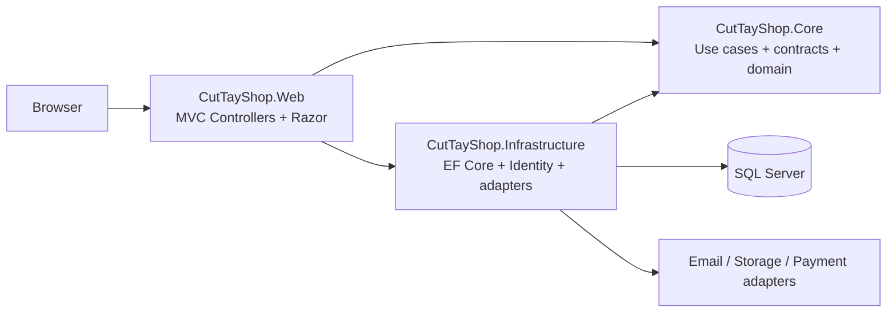
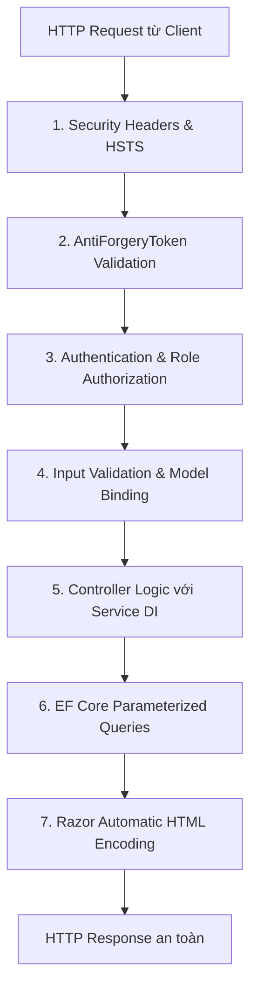

# 08 — KIẾN TRÚC KỸ THUẬT ASP.NET CORE MVC (TECHNICAL ARCHITECTURE)

**Dự án:** CutTayShop — Nền tảng Thương mại Điện tử B2C Hiện đại  
**Nền tảng:** ASP.NET Core MVC  
**Ngôn ngữ:** C# 14 / .NET 10 LTS  
**Tác giả:** Senior ASP.NET Core MVC Architect & Technical Lead  

---

## 1. ĐÁNH GIÁ MÔI TRƯỜNG & TARGET FRAMEWORK

### 1.1. Hiện trạng SDK trên máy phát triển
- Đã cài đặt: `.NET SDK 10.0.402` (Runtime `Microsoft.AspNetCore.App 10.0.13`).
- Trạng thái hỗ trợ tại ngày 28/10/2026: .NET 10 là LTS đang hoạt động đến 14/11/2028; .NET 8 kết thúc hỗ trợ ngày 10/11/2026. Nguồn: [Microsoft .NET Support Policy](https://dotnet.microsoft.com/en-us/platform/support/policy).
- `dotnet --info` phát sinh lỗi khi đọc metadata workload installer dù vẫn trả về SDK/runtime. M1 phải chạy lại `dotnet --info`, `dotnet new mvc` trong thư mục tạm và `dotnet build` trước khi scaffold solution thật.

### 1.2. Khuyến nghị chính thức cho CutTayShop
- **Target Framework:** `net10.0`. Không lập kế hoạch hạ cấp sang `net8.0` vì .NET 8 gần hết vòng hỗ trợ; nếu hạ tầng chưa chạy .NET 10 thì xử lý hạ tầng trước khi bắt đầu M1.
- **Lý do lựa chọn:**
  * Đây là LTS hiện hành và đúng phiên bản SDK đã cài tại máy phát triển.
  * ASP.NET Core, EF Core và Identity có thể giữ cùng major version 10 để giảm xung đột dependency.
  * Tránh bắt đầu dự án mới trên .NET 8 ngay trước ngày kết thúc hỗ trợ.

### 1.3. Chiến lược CSS và JavaScript
- **Chọn:** CSS thuần theo feature dùng CSS custom properties từ CutTay Design System (`tokens.css`, `base.css`, `components/*.css`, `pages/*.css`) và JavaScript ES modules nhỏ theo component.
- **Không bắt buộc Tailwind trong M1:** Razor MVC không cần build pipeline Node để render; lựa chọn này giảm dependency, giúp class name mang ngữ nghĩa và giữ prototype gần production. Các cột “Tailwind Class” trong tài liệu design system chỉ là ánh xạ tham khảo.
- **Có thể đánh giá lại Tailwind sau M2** nếu số lượng utility lặp lại gây chi phí bảo trì rõ ràng; việc thêm build step cần ADR riêng.

---

## 2. KIẾN TRÚC TỔNG THỂ SOLUTION (CLEAN ARCHITECTURE N-TIER)

Hệ thống được tổ chức theo mô hình phân tầng chặt chẽ (Clean N-Tier Architecture), phân tách độc lập giữa Tầng trình diễn (Presentation), Tầng nghiệp vụ cốt lõi (Core/Application) và Tầng hạ tầng dữ liệu (Infrastructure):



Dependency rule: Core không tham chiếu Web/Infrastructure; Web chỉ dùng implementation qua DI. External adapter chưa có ở Phase 0 và payment production không nằm trong MVP.

```
D:\Projects\CutTayShop - ASP\
├── CutTayShop.sln
│
├── src/
│   ├── CutTayShop.Core/                  # Tầng nghiệp vụ cốt lõi (Domain & Application)
│   │   ├── Entities/                     # Entity Framework Domain Models (POCO)
│   │   ├── Enums/                        # Trạng thái Đơn hàng, Thanh toán, Role...
│   │   ├── Interfaces/                   # Hợp đồng Dịch vụ (Service Interfaces)
│   │   │   └── Services/                 # IProductService, ICartService, IOrderService...
│   │   ├── DTOs/                         # Data Transfer Objects trao đổi giữa các tầng
│   │   └── Exceptions/                   # Domain Specific Exceptions (NotFound, OutOfStock...)
│   │
│   ├── CutTayShop.Infrastructure/        # Tầng hạ tầng kỹ thuật (Data Access & External Services)
│   │   ├── Data/                         # EF Core ApplicationDbContext, SeedData
│   │   ├── Configurations/               # Fluent API Entity Type Configurations
│   │   ├── Queries/                      # Truy vấn EF Core chuyên biệt theo use case
│   │   ├── Identity/                     # ApplicationUser, ApplicationRole
│   │   ├── Services/                     # EmailSender, LocalFileStorage, VietQRService
│   │   └── Migrations/                   # Database Migrations
│   │
│   └── CutTayShop.Web/                   # Tầng trình diễn (ASP.NET Core MVC Application)
│       ├── Controllers/                  # HomeController, ProductController, CartController...
│       ├── Areas/
│       │   └── Admin/                    # Phân vùng Quản trị độc lập
│       │       ├── Controllers/          # DashboardController, ProductController, OrderController...
│       │       ├── ViewModels/           # Admin-specific ViewModels
│       │       └── Views/                # Razor Views cho Admin
│       ├── ViewModels/                   # Strongly-typed ViewModels cho Storefront
│       ├── ViewComponents/               # HeaderCartViewComponent, CategoryNavViewComponent...
│       ├── TagHelpers/                   # Custom TagHelpers cho Price format, Status badge
│       ├── Views/
│       │   ├── Shared/                   # _Layout.cshtml, _Header.cshtml, _Footer.cshtml...
│       │   └── Home/, Product/, Cart/... # Razor Views theo từng Controller
│       └── wwwroot/                      # Static Assets (CSS, JS, Images, SVG Doodles)
```

---

## 3. LỰA CHỌN CƠ SỞ DỮ LIỆU (DATABASE SELECTION)

So sánh giữa các phương án lưu trữ phổ biến cho ứng dụng ASP.NET Core:

| Tiêu chí | Microsoft SQL Server (Khuyến nghị Chính) | SQLite | PostgreSQL |
| :--- | :--- | :--- | :--- |
| **Tính tương thích ASP.NET Core** | Provider chính hãng `Microsoft.EntityFrameworkCore.SqlServer`; phù hợp stack Microsoft. | Nhẹ nhưng khác concurrency/full-text production. | Provider Npgsql trưởng thành; phù hợp Linux/managed hosting. |
| **Xử lý giao dịch & Concurrency** | Cực mạnh với cơ chế khóa hàng (Row-level locking) và Snapshot Isolation, bảo vệ tồn kho Flash Sale. | Kém khi có nhiều request ghi đồng thời (File-locking). | Rất mạnh, hỗ trợ tốt cho môi trường Linux. |
| **Hỗ trợ kiểu JSON & Fulltext** | Có sẵn `JSON_VALUE`, Full-Text Search cho tìm kiếm sản phẩm tiếng Việt. | Giới hạn. | Rất mạnh (`GIN index`, `tsvector`). |
| **Môi trường phát triển** | Sử dụng **SQL Server LocalDB / Express** trên Windows hoặc Docker Container. | Cực nhẹ, không cần cài server. | Cần Docker hoặc cài dịch vụ. |

**Quyết định kiến trúc:**
- **Môi trường phát triển (Development):** Ưu tiên SQL Server LocalDB/container **sau khi xác minh có sẵn**. SQLite chỉ cho test nhẹ không phụ thuộc SQL Server; concurrency/full-text phải integration-test trên SQL Server.
- **Môi trường triển khai (Production):** Sử dụng **Microsoft SQL Server Standard / Azure SQL Database** để đảm bảo khả năng mở rộng, toàn vẹn giao dịch và sao lưu an toàn.
- **Data access:** Dùng `DbContext` + service/query object trực tiếp; không tạo `IGenericRepository<T>`/`IUnitOfWork` chung vì EF Core đã cung cấp các vai trò này. Chỉ tạo abstraction khi cần thay thế một nguồn dữ liệu hoặc cô lập use case phức tạp.

---

## 4. CHIẾN LƯỢC XÁC THỰC & PHÂN QUYỀN (AUTHENTICATION & AUTHORIZATION)

### 4.1. Cơ chế Xác thực (Authentication)
- Dựa trên **ASP.NET Core Identity** kết hợp **Cookie-based Authentication**.
- Mã hóa mật khẩu: Thuật toán chuẩn PBKDF2 với HMAC-SHA512.
- Bảo vệ phiên đăng nhập:
  * Cookie mang cờ `HttpOnly = true` (chống đánh cắp qua JavaScript XSS).
  * Cookie mang cờ `Secure = CookieSecurePolicy.Always` trên môi trường HTTPS.
  * Cấu hình `SameSite = SameSiteMode.Lax` để cân bằng giữa bảo mật và trải nghiệm người dùng khi redirect từ cổng thanh toán.

### 4.2. Cơ chế Phân quyền (Role & Policy-based Authorization)
Hệ thống định nghĩa 3 role nền:
1. `Customer`: Khách hàng mua sắm, chỉ truy cập được tài khoản cá nhân, đơn hàng của mình.
2. `Staff`: Nhân viên vận hành cửa hàng, có quyền xem danh sách đơn hàng, cập nhật trạng thái đóng gói, quản lý bài viết blog.
3. `Admin`: Quản trị viên tối cao, toàn quyền quản lý cấu hình hệ thống, doanh thu, phân quyền nhân sự, tạo khuyến mãi.

Nghiệp vụ dùng policy capability `ManageCatalog`, `ManageOrders`, `ManageContent`, `ManageCustomers`, `ManagePromotions`, `ManageSettings`, `ViewReports`; role chỉ là cách cấp các capability này. **Áp dụng kiểm soát tại Controller/action:**
```csharp
[Area("Admin")]
[Authorize(Policy = "ManageOrders")]
public class OrderController : Controller { ... }

[Area("Admin")]
[Authorize(Policy = "ManageSettings")]
public class SettingController : Controller { ... }
```

---

## 5. THIẾT KẾ RAZOR VIEW, VIEWCOMPONENTS & VIEWMODELS

### 5.1. Nguyên tắc Tuyệt đối Chống Overposting (Mass Assignment)
- **Cấm kỵ:** Không bao giờ truyền trực tiếp Entity Framework Model (ví dụ `Product`, `Order`, `ApplicationUser`) vào `[HttpPost]` Action của Controller.
- **Bắt buộc:** 100% dữ liệu từ Client gửi lên phải thông qua các **Strongly-typed ViewModels** hoặc **Commands** chuyên biệt (ví dụ `CreateProductViewModel`, `CheckoutViewModel`).
- **Validation:** Kết hợp DataAnnotations (`[Required]`, `[StringLength]`, `[RegularExpression]`) tại ViewModel và kiểm tra tính hợp lệ `ModelState.IsValid` phía Server trước khi ghi dữ liệu.

### 5.2. View Components tái sử dụng có logic Server
Thay vì nhồi nhét code vào Controller hoặc dùng `ViewBag`/`ViewData` không an toàn kiểu, các khối động được đóng gói thành các **View Component**:
1. `HeaderCartViewComponent`: Đọc session/cookie giỏ hàng và render số lượng badge kèm tổng tiền nhỏ trên Header.
2. `CategoryNavViewComponent`: Lấy danh sách 10 ngành hàng kèm icon và màu pastel từ cache để render dải danh mục.
3. `FlashSaleViewComponent`: Tính toán thời gian còn lại của phiên Deal Hot và lấy danh sách sản phẩm giảm giá.
4. `CutTayAiWidgetViewComponent`: Render widget chat trợ lý ảo và các câu hỏi gợi ý phù hợp với ngữ cảnh trang hiện tại.

---

## 6. QUẢN LÝ TỆP TIN & HÌNH ẢNH (IMAGE STORAGE ABSTRACTION)

Để không phụ thuộc cứng vào ổ cứng cục bộ, hệ thống trừu tượng hóa dịch vụ lưu trữ file qua interface:

```csharp
public interface IFileStorageService
{
    Task<string> UploadProductImageAsync(IFormFile file, string subFolder = "products");
    Task DeleteFileAsync(string relativePath);
}
```

**Quy trình xử lý ảnh an toàn khi Admin tải lên:**
1. Kiểm tra phần mở rộng (White-list extensions: `.webp`, `.jpg`, `.jpeg`, `.png`).
2. Kiểm tra chữ ký file (Magic bytes) để ngăn chặn mã độc đội lốt file ảnh.
3. Giới hạn dung lượng tối đa: `5MB` mỗi ảnh.
4. Tự động đổi tên file sang GUID ngẫu nhiên (ví dụ `7a8b9c0d-1234-5678.webp`) để chống tấn công Path Traversal.
5. Lưu trữ tại đường dẫn an toàn `wwwroot/uploads/{subFolder}/`.

---

## 7. BẢO MẬT HỆ THỐNG TOÀN DIỆN (SECURITY BLUEPRINT)



1. **Chống tấn công CSRF (Cross-Site Request Forgery):**
   * Kích hoạt tự động xác thực token cho toàn bộ các method ghi dữ liệu:
     ```csharp
     services.AddControllersWithViews(options => {
         options.Filters.Add(new AutoValidateAntiforgeryTokenAttribute());
     });
     ```
2. **Chống tấn công XSS (Cross-Site Scripting):**
   * Razor View Engine tự động HTML-Encode tất cả biểu thức `@Model.Property`.
   * Cấu hình Content-Security-Policy (CSP) hạn chế nạp script không an toàn.
3. **Chống tấn công IDOR (Insecure Direct Object Reference):**
   * Khi khách hàng xem hoặc hủy đơn hàng tại `/tai-khoan/don-hang/{code}`, Service luôn truy vấn kết hợp:
     `db.Orders.FirstOrDefaultAsync(o => o.OrderCode == code && o.UserId == currentUserId)`
   * Người dùng không bao giờ xem được đơn hàng của người khác chỉ bằng cách đổi mã đơn trên URL.

---

## 8. CHIẾN LƯỢC CACHING & HIỆU NĂNG CAO (PERFORMANCE STRATEGY)

1. **Caching Danh mục & Cấu hình Trang chủ:**
   * Sử dụng `IMemoryCache` cho dữ liệu tĩnh ít thay đổi (danh mục, thương hiệu, banner) với thời gian hết hạn trượt (Sliding Expiration: 30 phút).
   * Tự động xóa cache (Cache Invalidation) khi Admin cập nhật danh mục hoặc sửa banner.
2. **Tối ưu hóa Truy vấn Entity Framework Core:**
   * Sử dụng `.AsNoTracking()` cho truy vấn chỉ đọc khi không cần change tracking; đo allocation/query time trước khi tuyên bố mức cải thiện.
   * Sử dụng Split Query (`.AsSplitQuery()`) khi nạp sản phẩm kèm nhiều ảnh và biến thể để tránh hiện tượng bùng nổ tích Descartes (Cartesian explosion).
3. **Phân trang an toàn (Safe Pagination):**
   * Giới hạn kích thước trang tối đa (`MaxPageSize = 50`) để ngăn chặn việc người dùng cố tình truyền `pageSize=100000` làm tràn bộ nhớ máy chủ.

---

## 9. ROUTING, SERVICE CONTRACTS & REQUEST FLOW

### 9.1. Routing chuẩn

Thứ tự route phải từ cụ thể đến tổng quát để `/san-pham/{slug}` không nuốt các endpoint khác:

```csharp
app.MapControllerRoute(
    name: "areas",
    pattern: "{area:exists}/{controller=Dashboard}/{action=Index}/{id?}");

app.MapControllerRoute(
    name: "product-detail",
    pattern: "san-pham/{slug}",
    defaults: new { controller = "Catalog", action = "Detail" });

app.MapControllerRoute(
    name: "default",
    pattern: "{controller=Home}/{action=Index}/{id?}");
```

- Slug được chuẩn hóa chữ thường, dấu gạch ngang và có unique index; slug cũ redirect 301 qua bảng lịch sử slug.
- Admin dùng `Area("Admin")`; endpoint JSON vẫn qua MVC controller có route attribute `/api/v1/...`, không tách sang SPA.
- Ma trận route duy nhất nằm tại `docs/02_SITEMAP_AND_ROUTES.md`; controller/action triển khai phải khớp tài liệu đó.

### 9.2. Service interfaces tối thiểu

| Interface | Trách nhiệm | Không được làm |
| :--- | :--- | :--- |
| `ICatalogService` | PLP/PDP, facet, sort, pagination, slug lookup | Không nhận/trả EF entity cho View |
| `IPricingService` | Giá hiệu lực, promotion, snapshot order item | Không tin giá gửi từ client |
| `ICartService` | Merge giỏ khách/tài khoản, quantity, coupon preview | Không xác nhận tồn kho cuối cùng |
| `ICheckoutService` | Revalidate giá/kho/coupon, idempotency, tạo order | Không gọi cổng thanh toán production ở Phase 0/M1 |
| `IOrderService` | Ownership check, state transition, cancel/refund request | Không cho controller tự đổi trạng thái |
| `IInventoryService` | Available/reserved, atomic reservation/release | Không dùng số lượng từ UI làm nguồn thật |
| `IIdentityContext` | User id/roles hiện tại ở tầng application | Không truyền `HttpContext` vào Core |
| `IFileStorageService` | Validate/store/delete asset qua abstraction | Không ghép đường dẫn từ input người dùng |
| `IEmailSender` | Gửi email qua queue/outbox | Không làm request checkout chờ SMTP |

Controller chỉ map request → ViewModel/command → service → View/redirect. Transaction tạo order, order items và reservation thuộc một application service; không phân tán qua nhiều controller.

### 9.3. Search, filter, sort và pagination

- Query string chuẩn: `q`, `category`, `brand`, `minPrice`, `maxPrice`, `rating`, `inStock`, `sort`, `page`; `pageSize` do server giới hạn 24 (tối đa 48).
- Chỉ chấp nhận sort allow-list: `relevance`, `newest`, `best-selling`, `price-asc`, `price-desc`, `rating`.
- Filter không hợp lệ trả lại trang với giá trị đã chuẩn hóa; không ghép raw SQL từ query string.
- MVP dùng SQL Server Full-Text Search nếu môi trường hỗ trợ, có fallback tìm kiếm có dấu/không dấu đã xác định. Search engine riêng chỉ cân nhắc khi có số liệu tải thực tế.
- Canonical URL bỏ tham số trình bày không ảnh hưởng nội dung; trang lọc sâu mặc định `noindex,follow` để tránh nổ số lượng URL SEO.

---

## 10. CART, SESSION & CONCURRENCY

- Khách vãng lai nhận cookie ngẫu nhiên `cart_id` dạng opaque, `HttpOnly`, `Secure`, `SameSite=Lax`; database là nguồn thật, cookie không chứa giá hoặc danh sách item.
- Khi đăng nhập, merge giỏ theo `ProductVariantId`; quantity sau merge bị chặn bởi tồn khả dụng. Thao tác merge phải idempotent.
- Mọi lần hiển thị giỏ chỉ là báo giá tạm tính. Checkout luôn đọc lại giá, promotion, coupon, phí vận chuyển và tồn kho trên server.
- `Order` có idempotency key duy nhất theo người dùng/phiên để chống double-submit. Inventory dùng concurrency token/row version và transaction phù hợp; xung đột trả lỗi nghiệp vụ rõ ràng thay vì oversell.
- Session chỉ lưu UI state ngắn hạn; không lưu quyền, giá, tồn kho hoặc trạng thái thanh toán làm nguồn thật.

---

## 11. LOGGING, ERROR HANDLING & OPERATIONS

- Dùng structured logging qua `ILogger<T>`; gắn `TraceIdentifier`, `OrderCode` (khi có) và route. Không log mật khẩu, token reset, cookie, địa chỉ đầy đủ hoặc payload thanh toán.
- Production bật `UseExceptionHandler("/500")`, `UseStatusCodePagesWithReExecute("/{0}")` theo mapping 403/404; Development mới dùng trang exception chi tiết.
- Lỗi domain (`OutOfStock`, `CouponInvalid`, `InvalidOrderTransition`) được map thành ModelState/problem response có mã ổn định; lỗi không dự kiến trả thông báo chung và log exception.
- Health checks tối thiểu: process, database; email/storage/payment adapter chỉ thêm khi triển khai thật.
- Audit log bắt buộc cho thao tác Admin: thay giá, tồn kho, trạng thái đơn, coupon, role và settings; lưu actor, thời gian, before/after đã lọc dữ liệu nhạy cảm.

---

## 12. SECURITY DECISION CHECKLIST CHO M1

1. Mọi action thay đổi dữ liệu dùng POST/PUT/DELETE, authorization và antiforgery; GET không tạo side effect.
2. Resource của khách luôn query kèm `UserId`; resource Admin dùng policy theo capability thay vì chỉ ẩn nút UI.
3. ViewModel dùng allow-list property; file upload kiểm magic bytes, kích thước, tên ngẫu nhiên và không thực thi.
4. Rich text blog chỉ nhận HTML qua sanitizer allow-list; không render `Html.Raw` với dữ liệu chưa làm sạch.
5. CSP triển khai theo nonce/hash khi có inline script; không bật `'unsafe-inline'` chỉ để né lỗi.
6. Rate limit áp dụng cho login, reset password, order lookup, contact và AI endpoint; thông báo đăng nhập/reset không để lộ tài khoản tồn tại.
7. Secret nằm trong user-secrets/secret store, không commit connection string hoặc API key.

---

*Kiến trúc này là quyết định Phase 0 để triển khai và kiểm chứng ở M1; chưa có mã production, migration hoặc kết quả benchmark nào được tuyên bố trong tài liệu này.*
