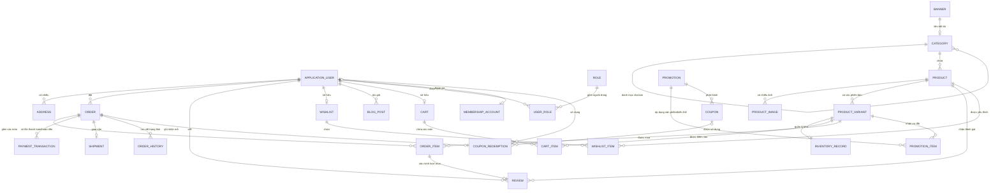
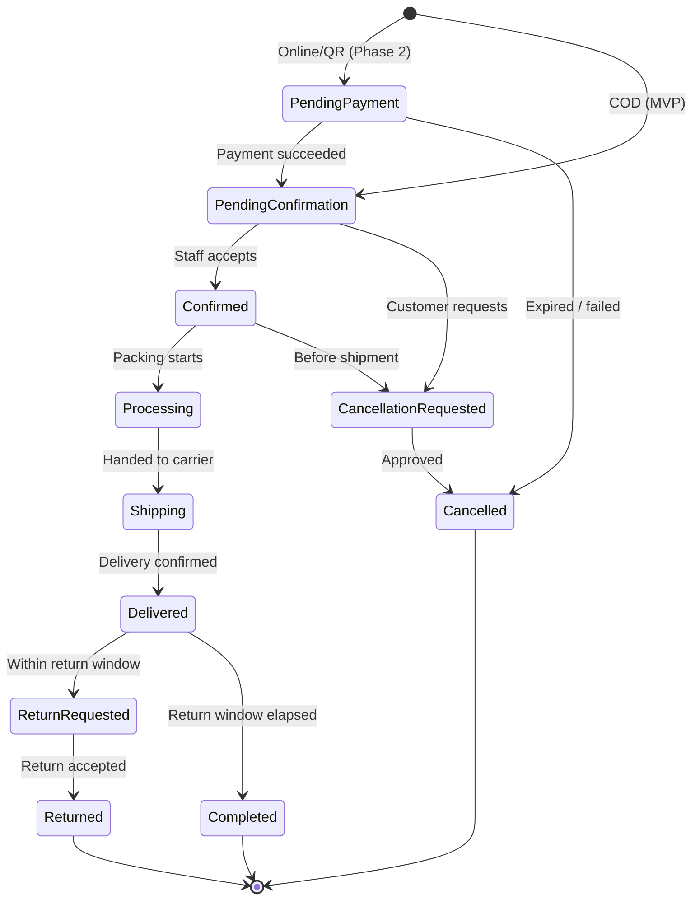
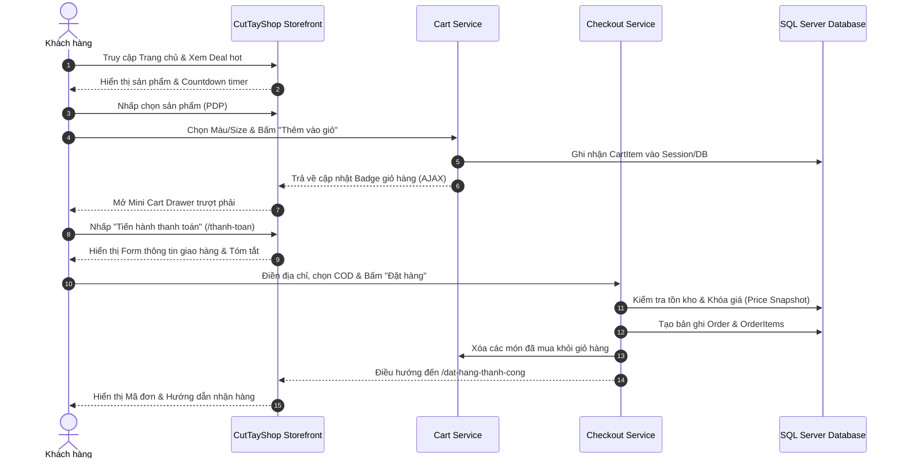
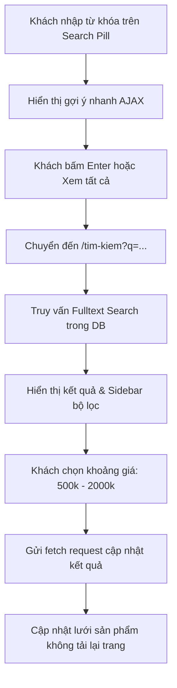
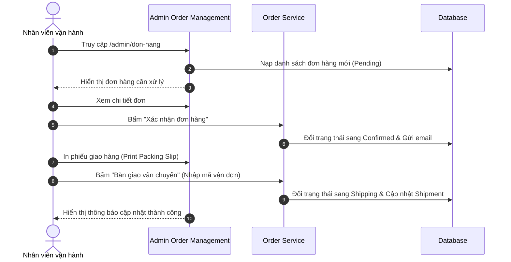
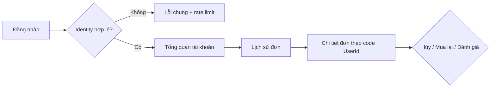
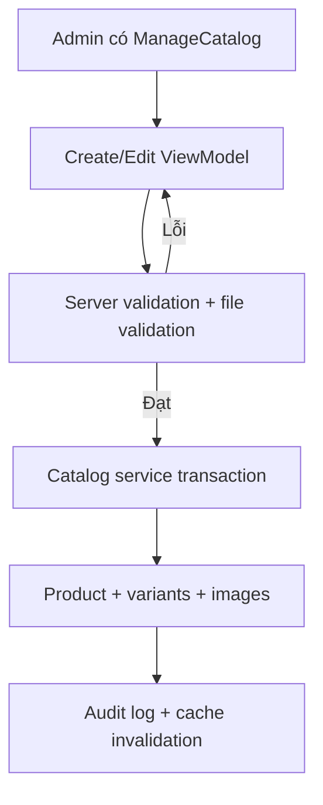
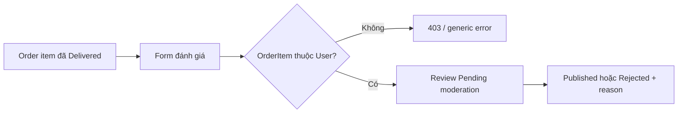
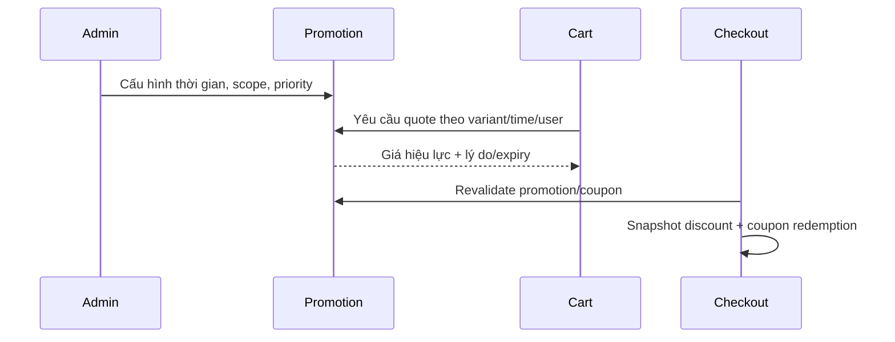

# 09 — MÔ HÌNH DỮ LIỆU & CÁC LUỒNG NGHIỆP VỤ (DATA MODEL & USER FLOWS)

**Dự án:** CutTayShop — Nền tảng Thương mại Điện tử B2C Hiện đại  
**Nền tảng:** Entity Framework Core (Code-First) / SQL Server  
**Giai đoạn:** Phase 0 — Khái niệm và Đặc tả Logic Nghiệp vụ (Chưa tạo Migration thực tế)  

---

## 1. SƠ ĐỒ THỰC THỂ QUAN HỆ KHÁI NIỆM (MERMAID ERD)

---

## 2. ĐẶC TẢ CHI TIẾT CÁC THỰC THỂ CỐT LÕI (ENTITY DEFINITIONS)

### 2.1. Nhóm Người Dùng & Tài Khoản (Customer & Identity)
1. **ApplicationUser (Kế thừa IdentityUser<Guid>):**
   * `Id`: Khóa chính định danh duy nhất (GUID).
   * `FullName`: Họ và tên hiển thị của người dùng (nvarchar(150)).
   * `AvatarUrl`: Đường dẫn ảnh đại diện.
   * `CreatedAt`: Ngày tạo tài khoản (DateTimeOffset).
   * `IsActive`: Trạng thái kích hoạt (bool).
   * `DefaultAddressId`: Khóa ngoại trỏ đến địa chỉ giao hàng mặc định.
2. **Address:**
   * `Id`: Khóa chính (int).
   * `UserId`: Khóa ngoại liên kết người dùng.
   * `RecipientName`, `PhoneNumber`: Tên và số điện thoại người nhận hàng.
   * `ProvinceCode`, `ProvinceName`: Mã và tên Tỉnh / Thành phố.
   * `DistrictCode`, `DistrictName`: Mã và tên Quận / Huyện.
   * `WardCode`, `WardName`: Mã và tên Phường / Xã.
   * `StreetAddress`: Số nhà, tên đường chi tiết.
   * `IsDefault`: Cờ đánh dấu địa chỉ mặc định.
3. **Role / UserRole:** Dùng schema ASP.NET Core Identity; role vận hành gắn policy capability (`ManageCatalog`, `ManageOrders`, `ManageContent`, `ManageCustomers`, `ManagePromotions`, `ManageSettings`, `ViewReports`) thay vì kiểm tra một role rộng ở mọi action.
4. **MembershipAccount (Hội viên CutTayShop+):**
   * `UserId`: Khóa ngoại 1-1 với ApplicationUser.
   * `CurrentPoints`: Số điểm tích lũy khả dụng. Quy tắc chuẩn: **1 điểm cho mỗi 1.000₫ giá trị hàng đủ điều kiện của đơn Completed**; điểm chỉ có hiệu lực sau cửa sổ đổi trả và bị đảo khi hoàn tiền.
   * `Tier`: Hạng hội viên (`Bronze`, `Silver`, `Gold`, `Diamond`).
   * `TotalSpent`: Tổng số tiền đã chi tiêu tích lũy theo năm.

### 2.2. Nhóm Danh Mục & Sản Phẩm (Catalog & Inventory)
1. **Category:**
   * `Id`: Khóa chính (int).
   * `Name`: Tên danh mục (ví dụ "Đồ công nghệ", "Thời trang").
   * `Slug`: Chuỗi định danh URL duy nhất (ví dụ "do-cong-nghe").
   * `IconName`: Tên icon đại diện (ví dụ "device-mobile", "t-shirt").
   * `PastelBgColor`: Mã màu nền pastel trích xuất từ ảnh mẫu (ví dụ `#E0F2FE`, `#FFE5DA`).
   * `ParentId`: Khóa ngoại tự tham chiếu danh mục cha (hỗ trợ phân cấp đa tầng).
   * `DisplayOrder`: Thứ tự hiển thị trên trang chủ và menu.
2. **Product:**
   * `Id`: Khóa chính (int).
   * `Name`: Tên sản phẩm đầy đủ (nvarchar(250)).
   * `Slug`: Đường dẫn SEO duy nhất (nvarchar(250)).
   * `Sku`: Mã quản lý sản phẩm gốc.
   * `CategoryId`: Khóa ngoại trỏ về Category.
   * `Brand`: Thương hiệu sản phẩm.
   * `ShortDescription`: Mô tả ngắn gọn hiển thị trên thẻ và kết quả tìm kiếm.
   * `FullDescription`: Nội dung chi tiết chuẩn bị cho Rich Text / Markdown.
   * `OriginalPrice`: Giá niêm yết ban đầu (decimal(18,2)).
   * `SalePrice`: Giá bán thực tế sau khuyến mãi (decimal(18,2)).
   * `DiscountPercent`: Phần trăm giảm giá tính sẵn để hiển thị badge (ví dụ `40`).
   * `IsFeatured`, `IsFlashSale`: Cờ phân loại hiển thị trên trang chủ.
   * `RatingAverage`: Điểm đánh giá trung bình từ 1.0 đến 5.0.
   * `ReviewCount`: Tổng số lượt đánh giá của khách hàng.
   * `IsActive`: Trạng thái mở bán (Soft delete khi ẩn).
3. **ProductVariant (Biến thể sản phẩm):**
   * `Id`: Khóa chính (int).
   * `ProductId`: Khóa ngoại liên kết với Product cha.
   * `Sku`: Mã phân loại biến thể (ví dụ `AIRBUDS-PRO-WHT`).
   * `ColorName`, `ColorHex`: Tên màu và mã màu biểu thị (ví dụ "Trắng ngà", `#FFFFFF`).
   * `Size`: Kích thước (ví dụ "FreeSize", "XL", "42").
   * `PriceAdjustment`: Giá chênh lệch so với giá gốc của sản phẩm cha.
   * Giá hiệu lực = `BasePrice + PriceAdjustment`, sau đó `IPricingService` áp promotion có thời hạn; không lưu `StockQuantity` trùng lặp tại Variant.
4. **ProductImage:**
   * `Id`: Khóa chính (int).
   * `ProductId`: Khóa ngoại.
   * `VariantId`: Khóa ngoại tùy chọn (ảnh riêng cho từng màu).
   * `ImageUrl`: Đường dẫn tệp ảnh an toàn (chuẩn WebP).
   * `IsMain`: Ảnh bìa đại diện chính.
   * `DisplayOrder`: Thứ tự trình chiếu trong gallery.
5. **InventoryRecord (nguồn sự thật tồn kho):**
   * `ProductVariantId` unique, `OnHandQuantity`, `ReservedQuantity`, `ReorderLevel`, `UpdatedAt`, `RowVersion` concurrency token.
   * `AvailableQuantity = OnHandQuantity - ReservedQuantity`; mọi reserve/release/commit nằm trong transaction và không cho giá trị âm.

### 2.3. Nhóm Giỏ Hàng & Đơn Hàng (Cart & Orders)
1. **Cart & CartItem:**
   * `Cart.Id`: Khóa chính (Guid).
   * `Cart.UserId`: Khóa ngoại (null nếu là khách vãng lai).
   * `Cart.SessionKey`: Khóa định danh giỏ hàng lưu trong Cookie trình duyệt.
   * `CartItem.ProductVariantId`: Khóa ngoại trỏ đến biến thể đã chọn.
   * `CartItem.Quantity`: Số lượng đặt.
   * `CartItem.AddedAt`: Thời điểm thêm vào giỏ.
2. **Order (Đơn hàng):**
   * `Id`: Khóa chính (int).
   * `OrderCode`: Mã đơn hàng công khai hiển thị cho khách (ví dụ `CTS-20261028-A89F`).
   * `UserId`: Khóa ngoại người đặt (null nếu mua dạng khách vãng lai).
   * `CustomerName`, `CustomerPhone`, `CustomerEmail`: Thông tin người nhận snapshot.
   * `ShippingAddress`: Toàn bộ chuỗi địa chỉ giao hàng đã snapshot.
   * `SubTotal`: Tổng tiền hàng gốc trước khi giảm (decimal(18,2)).
   * `DiscountAmount`: Tổng số tiền giảm giá từ Voucher / Loyalty points.
   * `ShippingFee`: Phí giao hàng tính toán.
   * `TotalAmount`: **Tổng số tiền khách hàng phải thanh toán cuối cùng (Snapshot cố định)**.
   * `PaymentMethod`: `COD` ở MVP; `VietQR`, `VNPAY`, `MoMo` là giá trị dự kiến cho Phase 2/Future sau khi có adapter thật.
   * `PaymentStatus`: `Unpaid`, `Pending`, `Paid`, `PartiallyRefunded`, `Refunded`, `Failed`.
   * `OrderStatus`: dùng tập trạng thái canonical tại mục 3.3; không tạo enum rút gọn khác ở tài liệu/mã nguồn.
   * `CreatedAt`: Ngày tạo đơn.
3. **OrderItem (Chi tiết dòng sản phẩm trong đơn):**
   * `Id`: Khóa chính (int).
   * `OrderId`: Khóa ngoại trỏ về Order.
   * `ProductVariantId`: Khóa ngoại trỏ về biến thể.
   * `ProductName`: **Tên sản phẩm snapshot tại thời điểm mua**.
   * `VariantName`: **Tên biến thể snapshot (Màu, Size)**.
   * `UnitPrice`: **Đơn giá bán thực tế snapshot tại thời điểm đặt hàng**.
   * `Quantity`: Số lượng mua.
   * `TotalPrice`: Thành tiền của dòng hàng (`UnitPrice * Quantity`).

### 2.4. Thanh toán, vận chuyển, khuyến mãi, nội dung & tương tác

1. **PaymentTransaction:** `Id`, `OrderId`, `Provider`, `Type` (`Charge`, `Refund`), `ProviderReference`, `Amount`, `Status`, `IdempotencyKey`, `CreatedAt`. Một order có nhiều attempt/refund; không lưu PAN/CVV hoặc thông tin thẻ nhạy cảm.
2. **Shipment:** `Id`, `OrderId`, `Carrier`, `ServiceLevel`, `TrackingCode`, `Status`, `ShippedAt`, `DeliveredAt`, `ShippingFeeSnapshot`. Một shipment/order ở MVP; thiết kế không chặn split shipment về sau.
3. **Promotion / PromotionItem:** promotion có `Type`, `StartAt`, `EndAt`, `Priority`, `IsActive`; item nối ProductVariant và giữ `SalePrice` hoặc rule giảm. Không dùng `Product.IsFlashSale`/`SalePrice` không có thời hạn làm nguồn thật.
4. **Coupon / CouponRedemption:** coupon có code unique đã normalize, kiểu/giá trị giảm, min order, cap, thời gian, usage limit. Redemption nối coupon–order–user/session để enforce lượt dùng và audit.
5. **Review:** `Id`, `ProductId`, `OrderItemId?`, `UserId`, `Rating`, `Title`, `Content`, `Status`, timestamps. `OrderItemId` unique khi đánh dấu verified purchase; moderation không làm mất audit.
6. **Wishlist / WishlistItem:** một wishlist/user hoặc guest key; `(WishlistId, ProductId)` unique; merge idempotent khi login.
7. **Banner:** `Placement`, `Title`, `ImageUrl`, `AltText`, `TargetUrl`, `StartAt`, `EndAt`, `DisplayOrder`, `IsActive`; URL đích allow-list nội bộ hoặc HTTPS hợp lệ.
8. **BlogPost:** `Slug` unique, `Title`, `Excerpt`, `SanitizedHtml`, `Status`, `PublishedAt`, `AuthorId`, SEO fields; rich HTML phải sanitize allow-list trước render.

---

## 3. CÁC QUY TẮC NGHIỆP VỤ THEN CHỐT (CRITICAL BUSINESS RULES)

### 3.1. Quy tắc Snapshot Giá (Price Snapshotting Rule)
- **Vấn đề rủi ro:** Giá sản phẩm trên hệ thống có thể thay đổi bất kỳ lúc nào do Admin điều chỉnh hoặc do chương trình Flash Sale hết giờ.
- **Giải pháp bắt buộc:** Khi khách hàng bấm "Xác nhận đặt hàng", hệ thống lập tức sao chép (snapshot) toàn bộ thông tin tên sản phẩm, tên biến thể, đơn giá bán, số tiền giảm vào bảng `OrderItem`. Mọi thay đổi về giá của `Product` trong tương lai tuyệt đối không làm thay đổi số tiền ghi nhận trong các hóa đơn cũ.

### 3.2. Cơ chế Tạm giữ Tồn kho (Inventory Reservation Mechanism)
- Khi đơn hàng được tạo với phương thức thanh toán Online (VietQR / Chuyển khoản):
  * Hệ thống trừ kho tạm thời (`ReservedQuantity`) và tạo thời hạn giữ hàng (Expiry: 15 phút).
  * Nếu sau 15 phút không nhận được xác nhận thanh toán: Hệ thống tự động kích hoạt tiến trình giải phóng kho (Release Reservation), hoàn lại tồn kho cho người khác mua.
- Đối với phương thức COD: Tồn kho được trừ chính thức ngay khi đơn hàng chuyển sang trạng thái `Confirmed`.

### 3.3. Cỗ Máy Trạng Thái Đơn Hàng (Order State Machine)
Đơn hàng chuyển trạng thái theo allow-list; nhánh hủy/đổi trả đều đi qua service và audit log:

### 3.4. Quy tắc Áp dụng Mã Giảm Giá (Coupon Validation Rules)
Một mã giảm giá chỉ được coi là hợp lệ khi thỏa mãn đồng thời 6 điều kiện:
1. `IsActive == true` và thời gian hiện tại nằm giữa `StartDate` và `EndDate`.
2. Giá trị tạm tính của giỏ hàng `>= MinOrderAmount`.
3. Số lượt sử dụng còn lại (`MaxUsageCount - CurrentUsageCount > 0`).
4. Khách hàng chưa vượt quá giới hạn lượt dùng cá nhân (`MaxUsagePerUser`).
5. Nếu mã áp dụng cho danh mục cụ thể, giỏ hàng phải chứa ít nhất 1 sản phẩm thuộc danh mục đó.
6. Mỗi đơn hàng chỉ được áp dụng tối đa 1 mã giảm giá (Single coupon policy) để chống cộng dồn lỗ vốn.

### 3.5. State machine, hủy, trả hàng và hoàn tiền

- Canonical order states: `PendingPayment`, `PendingConfirmation`, `Confirmed`, `Processing`, `Shipping`, `Delivered`, `Completed`, `CancellationRequested`, `Cancelled`, `ReturnRequested`, `Returned`.
- Chỉ `IOrderService` được chuyển trạng thái theo allow-list; mỗi lần chuyển ghi `OrderHistory` và actor. `Completed` chỉ sau khi hết cửa sổ đổi trả hoặc quy trình đóng đơn.
- Hủy trước khi ship phải release reservation/khôi phục tồn theo trạng thái và vô hiệu coupon redemption; sau khi thanh toán tạo refund transaction, không sửa/xóa charge cũ.
- Return/refund luôn là nghiệp vụ riêng có lý do, số tiền, trạng thái và audit; refund có thể partial nhưng tổng refund không vượt số đã thu.

### 3.6. Reservation, phí vận chuyển và thanh toán

- Tất cả checkout phải reserve tồn kho atomically trước khi tạo order: online giữ 15 phút trong lúc chờ thanh toán; COD chuyển reservation thành committed khi xác nhận đơn. Hết hạn/hủy phải release idempotent.
- Phí ship được server tính và snapshot vào Order/Shipment. MVP: freeship tiêu chuẩn khi giá trị hàng sau giảm từ `499.000₫`; hàng cồng kềnh/vùng đặc biệt có rule rõ và hiển thị trước submit.
- MVP chỉ thu **COD**. VietQR/gateway ở Phase 2 sau khi có adapter, webhook signature, idempotency và reconciliation; không lưu dữ liệu thẻ.
- Giá, coupon, shipping và stock luôn revalidate ở submit; dữ liệu client chỉ là lựa chọn, không là nguồn tính tiền.

---

## 4. SƠ ĐỒ CÁC LUỒNG NGHIỆP VỤ CHÍNH (MERMAID USER FLOWS)

### 4.1. Luồng 1: Khách hàng Duyệt hàng & Mua hàng (End-to-End Shopping Flow)

### 4.2. Luồng 2: Tìm kiếm & Lọc Sản phẩm (Search & Faceted Browsing)

### 4.3. Luồng 3: Xử lý Đơn hàng Phía Quản trị viên (Admin Order Processing)

### 4.4. Luồng 4: Đăng nhập → Tài khoản → Lịch sử đơn

### 4.5. Luồng 5: Admin quản lý sản phẩm

### 4.6. Luồng 6: Khách hàng đánh giá

### 4.7. Luồng 7: Campaign → Discount → Checkout

---

*Đây là mô hình khái niệm Phase 0. Mọi index, transaction isolation và hiệu năng phải được chứng minh bằng migration/test ở các milestone triển khai; tài liệu không tuyên bố database thực tế đã tồn tại.*
