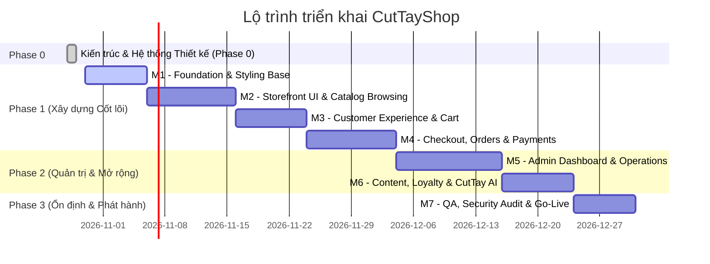

# 10 — LỘ TRÌNH TRIỂN KHAI DỰ ÁN (IMPLEMENTATION ROADMAP)

**Dự án:** CutTayShop — Nền tảng Thương mại Điện tử B2C Hiện đại  
**Công nghệ:** ASP.NET Core MVC, C#, Razor `.cshtml`, Entity Framework Core  
**Giai đoạn hiện tại:** Phase 0 (Thiết kế & Kiến trúc)  
**Quy tắc:** Chỉ lập kế hoạch chi tiết, không thực hiện mã nguồn sản phẩm trong Phase 0.

---

## 1. TỔNG QUAN CÁC CỘT MỐC (MILESTONES OVERVIEW)

---

## 2. CHI TIẾT TỪNG CỘT MỐC TRIỂN KHAI

### MILESTONE 1 (M1) — FOUNDATION & ARCHITECTURAL BASE
- **Mục tiêu:** Thiết lập cấu trúc solution ASP.NET Core MVC Clean Architecture, cấu hình hạ tầng dữ liệu ban đầu, nạp hệ thống Design Tokens và Layout Master cho toàn bộ website.
- **Scope (Phạm vi):**
  1. Khởi tạo Solution `CutTayShop.sln` gồm 3 dự án: `CutTayShop.Web`, `CutTayShop.Core`, `CutTayShop.Infrastructure`.
  2. Thiết lập Target Framework `net10.0`, khóa các package ASP.NET Core/EF Core cùng major version 10; dùng DataAnnotations + `IValidatableObject` cho validation ban đầu.
  3. Cấu hình DbContext, Connection String (SQL Server / SQLite Local), cấu hình DI container.
  4. Triển khai `CutTay Design System v1` vào `wwwroot/css/`: `variables.css`, `base.css`, `components.css`, `utilities.css`.
  5. Xây dựng Master Layout Storefront `_Layout.cshtml`, Header dùng Razor View Component, Footer, dải thông báo.
- **Deliverables (Sản phẩm bàn giao):**
  - Solution build thành công, 0 lỗi, 0 cảnh báo.
  - Trang mẫu kiểm tra Design System (`/dev/design-system-preview`) hiển thị đúng toàn bộ bảng màu, typography, button variants, input states.
  - Header và Footer hoàn thiện responsive từ 375px đến 1920px.
- **Dependencies (Phụ thuộc):** Không có (bắt đầu trực tiếp sau khi hoàn tất Phase 0).
- **Rủi ro kỹ thuật:** Lỗi metadata workload hiện có trong `dotnet --info`, xung đột package major version hoặc font web không tải được. Khắc phục: smoke-test SDK trước khi scaffold, pin package 10.x, self-host font WOFF2 có giấy phép phù hợp và dùng system fallback.
- **Acceptance Criteria (Tiêu chí nghiệm thu):**
  - Chạy `dotnet run` hiển thị trang chủ khung với Header chuẩn ảnh mẫu.
  - Không có lỗi console JavaScript, không giật layout.
- **Testing Requirements:** Unit test cho DI Registration, Integration test cho HTTP 200 trang chủ.

---

### MILESTONE 2 (M2) — STOREFRONT UI & CATALOG BROWSING
- **Mục tiêu:** Hiện thực hóa hierarchy, palette và component language của ảnh mẫu trong giao diện mua sắm công khai.
- **Scope (Phạm vi):**
  1. **Trang chủ (`HomeController`):** Hero section với headline lớn, highlight xanh pastel, doodles, lifestyle photo, 2 promo banner bên phải.
  2. **Dãy danh mục (Category Nav):** 10 danh mục bo góc mềm với icon pastel và hover bounce.
  3. **Dải cam kết dịch vụ (Trust Benefits):** 4 thẻ thông tin giao hàng, chính hãng, đổi trả, hỗ trợ 24/7.
  4. **Deal hot hôm nay (Flash Sale):** Countdown timer chạy realtime, grid thẻ sản phẩm có badge giảm giá, định dạng tiền tệ VND.
  5. **Trang danh sách sản phẩm (PLP - `CatalogController/Index|Category|Search`):** Bộ lọc đa tiêu chí (danh mục, khoảng giá, rating, thương hiệu), thanh sắp xếp, phân trang.
  6. **Trang chi tiết sản phẩm (PDP - `CatalogController/Detail`):** Thư viện ảnh thumbnail, chọn biến thể (màu sắc, kích thước), bộ đếm số lượng, tab thông số kỹ thuật, đánh giá.
- **Deliverables:**
  - Trang chủ hoàn thiện toàn bộ section.
  - Trang danh mục và trang chi tiết sản phẩm chuẩn UI/UX.
  - Razor View Components: `CategoryNavViewComponent`, `FlashSaleViewComponent`, `ProductCardViewComponent`.
- **Dependencies:** M1.
- **Rủi ro kỹ thuật:** Layout giật khi countdown timer cập nhật hoặc ảnh sản phẩm tải chậm. Khắc phục: Dùng `aspect-ratio: 1/1` và lazy loading cho ảnh bên dưới nếp gấp màn hình.
- **Acceptance Criteria:**
  - Giao diện đạt token/layout đã duyệt; sai khác được ghi bằng visual review/screenshot evidence.
  - Countdown timer hoạt động mượt mà, định dạng `DD : HH : MM : SS`.
  - Responsive kiểm tra đạt chuẩn tại 375px, 768px, 1024px, 1440px.

---

### MILESTONE 3 (M3) — CUSTOMER EXPERIENCE & SHOPPING CART
- **Mục tiêu:** Xây dựng luồng tương tác khách hàng mượt mà: xác thực tài khoản, quản lý danh sách yêu thích và giỏ hàng.
- **Scope:**
  1. **Xác thực (`AuthController`):** Đăng nhập, Đăng ký, Quên mật khẩu, Xác minh email, tích hợp ASP.NET Core Identity.
  2. **Quản lý tài khoản (`AccountController`, prefix `/tai-khoan`):** Trang tổng quan, cập nhật thông tin cá nhân, sổ địa chỉ nhận hàng (tỉnh/thành, quận/huyện, phường/xã).
  3. **Danh sách yêu thích (`WishlistController`):** Thêm/xóa sản phẩm yêu thích (lưu cookie cho khách vãng lai, đồng bộ database khi đăng nhập).
  4. **Giỏ hàng tương tác (`CartController`):**
     * Cart Drawer trượt từ bên phải khi nhấn vào icon giỏ hàng trên Header.
     * Trang giỏ hàng đầy đủ (`/gio-hang`): Tăng/giảm số lượng, xóa item, nhập mã voucher giảm giá, tính toán tạm tính và giảm giá.
     * Cập nhật số lượng hiển thị trên badge Header qua AJAX fetch không tải lại trang.
- **Deliverables:**
  - Hệ thống đăng nhập/đăng ký hoàn chỉnh bảo mật CSRF, mã hóa mật khẩu PBKDF2/Argon2.
  - Giỏ hàng hoạt động hoàn hảo cả dạng Mini Drawer và Full Page.
- **Dependencies:** M2.
- **Acceptance Criteria:**
  - Thêm sản phẩm vào giỏ cập nhật ngay lập tức badge giỏ hàng.
  - Giỏ hàng lưu trữ bền vững qua session/cookie của người dùng.

---

### MILESTONE 4 (M4) — CHECKOUT, ORDER PROCESSING & TRACKING
- **Mục tiêu:** Hoàn thiện luồng chuyển đổi mua hàng cốt lõi (Checkout funnel) từ giỏ hàng đến đặt hàng thành công.
- **Scope:**
  1. **Trang thanh toán (`CheckoutController`):**
     * Điền thông tin giao hàng (họ tên, số điện thoại, địa chỉ chi tiết, ghi chú).
     * Chọn phương thức vận chuyển (Giao tiêu chuẩn, Giao hỏa tốc).
     * MVP chỉ chọn COD; định nghĩa abstraction cho VietQR/VNPAY/MoMo nhưng không kết nối production trong M4.
     * Áp dụng mã giảm giá với validation thời gian thực.
  2. **Cơ chế Snapshotting & Reservation:**
     * Khóa giá sản phẩm tại thời điểm nhấn "Đặt hàng" (Order Snapshot).
     * Tạm giữ tồn kho (Inventory Reservation) trong 15 phút.
  3. **Trang xác nhận đơn hàng (`Checkout/Success`):** Hiển thị mã đơn, mã QR chuyển khoản nếu chọn ngân hàng, hướng dẫn nhận hàng.
  4. **Tra cứu đơn hàng (`OrderController`):** Cho phép khách chưa đăng nhập tra cứu bằng Mã đơn + Số điện thoại với rate limit, phản hồi chung và che dữ liệu nhạy cảm.
- **Deliverables:**
   - Hoàn chỉnh state machine canonical và các nhánh hủy/đổi trả tại `docs/09_DATA_MODEL_AND_USER_FLOWS.md`.
  - Gửi email xác nhận đơn hàng tự động cho khách.
- **Dependencies:** M3.
- **Rủi ro:** Đặt hàng trùng lặp khi người dùng bấm nút nhiều lần. Khắc phục: Idempotency Token trên form thanh toán và disable nút ngay khi submit.

---

### MILESTONE 5 (M5) — ADMIN DASHBOARD & STORE OPERATIONS
- **Mục tiêu:** Cung cấp khu vực quản trị chuyên nghiệp (`/Admin`) để vận hành toàn bộ cửa hàng thương mại điện tử.
- **Scope:**
  1. **Dashboard tổng quan:** Biểu đồ doanh thu (Chart.js / SVG), thống kê đơn hàng mới, cảnh báo tồn kho thấp.
  2. **Quản lý sản phẩm (`Admin/Product`):** Thêm mới, chỉnh sửa, xóa mềm (Soft delete), quản lý biến thể (Variants), tải ảnh lên thư mục an toàn, trình soạn thảo mô tả sản phẩm.
  3. **Quản lý danh mục (`Admin/Category`):** Cây danh mục cha/con, icon, màu sắc pastel đại diện.
  4. **Quản lý đơn hàng (`Admin/Order`):** Danh sách lọc theo trạng thái, cập nhật trạng thái đơn hàng (Xác nhận, Giao hàng, Hủy đơn), in phiếu giao hàng.
  5. **Quản lý kho (`Admin/Inventory`):** Theo dõi số lượng tồn kho, lịch sử nhập/xuất kho.
  6. **Quản lý khuyến mãi (`Admin/Coupon`):** Tạo mã giảm giá theo %, theo số tiền cố định, giới hạn lượt dùng và đơn hàng tối thiểu.
- **Deliverables:**
  - Admin Area có layout riêng, authenticated by default và policy capability theo action.
- **Dependencies:** M4.
- **Acceptance Criteria:**
  - Admin tạo sản phẩm mới thì lập tức xuất hiện đúng ngoài storefront.
  - Phân quyền chặt chẽ: Tài khoản khách hàng thường truy cập `/Admin` nhận lỗi 403 Forbidden.

---

### MILESTONE 6 (M6) — CONTENT, LOYALTY & CUTTAY AI ASSISTANT
- **Mục tiêu:** Gia tăng mức độ tương tác và chuyển đổi khách hàng qua nội dung blog, chương trình thành viên và trợ lý mua sắm AI.
- **Scope:**
  1. **Hệ thống Blog / Cẩm nang mua sắm (`BlogController`):** Danh sách bài viết, chi tiết bài viết, gợi ý sản phẩm liên quan trong nội dung.
  2. **Chương trình thành viên CutTayShop+ (`Membership`):** Tích điểm đơn hàng (1 điểm mỗi 1.000₫ đủ điều kiện; 1 điểm đổi 10₫), phân hạng Đồng - Bạc - Vàng - Kim Cương, đổi điểm lấy voucher.
  3. **Giao diện Trợ lý CutTay AI (không có LLM backend trong M6):**
     * Cửa sổ chat nổi góc phải màn hình chuẩn giao diện ảnh mẫu.
     * Các chip câu hỏi gợi ý nhanh ("Tư vấn sản phẩm phù hợp", "Kiểm tra đơn hàng", "Chương trình khuyến mãi").
     * Triển khai state machine UI, contract, privacy notice và fallback FAQ/Liên hệ; kết nối LLM/RAG là Future milestone cần phê duyệt riêng.
  4. **Hệ thống Banner & Homepage CMS:** Cho phép Admin thay đổi nội dung banner hero và khuyến mãi trực tiếp từ trang quản trị.
- **Deliverables:**
  - Hoàn thiện trải nghiệm cá nhân hóa và tương tác sinh động cho website.
- **Dependencies:** M5.

---

### MILESTONE 7 (M7) — QA, SECURITY AUDIT, PERFORMANCE & GO-LIVE
- **Mục tiêu:** Kiểm toán toàn diện chất lượng, bảo mật, tối ưu tốc độ và chuẩn bị triển khai lên môi trường máy chủ sản xuất.
- **Scope:**
  1. **Kiểm toán bảo mật (Security Audit):**
     * Rà soát chống SQL Injection (EF Core parameterized queries).
     * Rà soát chống Cross-Site Scripting (XSS) và Content-Security-Policy.
     * Rà soát chống CSRF (`[ValidateAntiForgeryToken]`).
     * Kiểm tra chống IDOR (Insecure Direct Object References) tại các endpoint cập nhật địa chỉ, xem chi tiết đơn hàng.
  2. **Tối ưu hóa hiệu năng (Performance Optimization):**
     * Nén ảnh tự động (WebP), nén dữ liệu HTTP (Gzip / Brotli).
     * Caching: Cấu hình `IMemoryCache` cho danh mục và cấu hình trang chủ.
     * Ngân sách p75 mobile production: LCP <= 2.5s, INP <= 200ms, CLS <= 0.1; lab test chỉ là tín hiệu sớm.
  3. **Kiểm toán tiếp cận (Accessibility WCAG 2.2 AA):**
     * Độ tương phản chữ và icon đạt tối thiểu 4.5:1.
     * Điều hướng bàn phím hoàn chỉnh (Tab, Esc đóng modal).
  4. **Kế hoạch Deployment:** Cấu hình Dockerfile tối ưu cho ASP.NET Core, script khởi tạo database và dữ liệu mẫu (Seeding).
- **Deliverables:**
  - Báo cáo kiểm thử bảo mật & hiệu năng đạt chuẩn xuất sắc.
  - Bộ cài đặt Docker / IIS sẵn sàng cho production.
- **Dependencies:** M1 đến M6.

---

## 3. MA TRẬN DELIVERY, RISK, ACCEPTANCE & TESTING

Bảng này bổ sung các trường bắt buộc còn thiếu trong phần mô tả milestone; scope/deliverable/dependency chi tiết vẫn lấy ở mục 2.

| Milestone | Rủi ro chính | Acceptance criteria có thể kiểm | Testing requirements |
| :--- | :--- | :--- | :--- |
| **M1** | SDK workload metadata, package major mismatch, font/CSS token drift | Solution `net10.0` build 0 error; `/dev/design-system-preview` và Home shell HTTP 200; header/footer không overflow tại 6 viewport | Unit DI registration; integration smoke; HTML validation; axe + keyboard smoke; visual snapshots 375/768/1440 |
| **M2** | Layout/route inconsistency, N+1 query, stale promotion | Home/PLP/PDP khớp route registry; filter/sort/pagination giữ query; out-of-stock CTA disabled; countdown chuyển đúng expired state | Unit pricing/filter; integration route + SQL query; responsive screenshot; axe; image/performance budget |
| **M3** | Cart merge duplicate, IDOR account, auth enumeration | Guest/login cart merge idempotent; account resource owner-only; email confirmation/lockout; cart quantity server-validated | Identity integration; authorization matrix; cart merge/property tests; CSRF; keyboard/form error tests |
| **M4** | Double-submit, oversell, stale quote, lookup enumeration | Idempotent checkout; atomic reservation; price/order snapshot; COD receipt protected; lookup rate-limited/masked | Transaction/concurrency integration on SQL Server; state-machine unit tests; antiforgery; cancellation/release regression |
| **M5** | Over-broad Staff role, unsafe upload, invalid state update | Policy per capability; upload magic-byte/size validation; audit log; Admin không bypass state machine | Policy matrix; file security; admin CRUD integration; audit assertions; table/form a11y |
| **M6** | Loyalty inconsistency, unsafe rich HTML, AI claims/privacy | Point rule khớp canonical doc; HTML sanitized; AI báo unavailable khi chưa có backend; banner schedule đúng | Loyalty/refund tests; sanitizer corpus; AI contract/error tests; CMS preview visual QA |
| **M7** | Lab-only confidence, secret leak, restore chưa diễn tập | Security/accessibility findings được triage; p75 budgets cấu hình; restore rehearsal; runbook/rollback được duyệt | Full regression; dependency/SAST; DAST có phạm vi; load; axe/manual SR; backup/restore/deploy smoke |

Mỗi milestone chỉ hoàn thành khi có evidence link cho acceptance tương ứng; mô tả kế hoạch không phải bằng chứng đạt.

---

*Lộ trình này là kế hoạch Phase 0; ngày bắt đầu/kết thúc chỉ được lập sau khi Phase 0 được duyệt và nguồn lực được xác nhận.*
