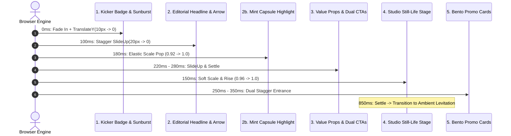

# CUTTAYSHOP — HOMEPAGE MOTION DESIGN SYSTEM
**Motion Tokens, Choreography Timelines & Interactive Physics**  
*Sprint: Homepage Editorial Motion Redesign (`feat/ui-homepage-editorial-motion-redesign`)*  
*Document Version: 1.0.0 — Production Delivery*

---

## 1. Motion Principles & Philosophy

The motion system for CutTayShop is designed to deliver a **silky, tactile, and restrained editorial experience**. Motion is never gratuitous; every animation serves either to direct user attention, establish visual hierarchy, or provide delightful tactile feedback.

### Core Motion Guidelines
1. **Composited GPU Properties Only:** Animations strictly animate `transform` and `opacity`. Never animate layout triggers such as `top`, `left`, `margin`, `width`, or `height`.
2. **Predictable Stagger Choreography:** Elements enter in a logical reading hierarchy (Kicker $\to$ Headline $\to$ Capsule $\to$ Value Props $\to$ CTAs $\to$ Still-Life $\to$ Promo Banners).
3. **Hardware & Battery Respect:** Continuous ambient floating loops automatically pause via `IntersectionObserver` when scrolled off-screen.
4. **Accessible by Default:** Full adherence to `prefers-reduced-motion: reduce`. Users who prefer reduced motion experience instant layout presentation without animations or transitions.

---

## 2. Motion Token Architecture (`motion-tokens.css`)

```css
:root {
  /* Durations */
  --motion-duration-fast: 180ms;       /* Micro-interactions, hover pops */
  --motion-duration-normal: 260ms;     /* Button states, drawer toggles */
  --motion-duration-entrance: 500ms;   /* Section reveals, card entrances */
  --motion-duration-ambient: 4000ms;   /* Background floating loops */

  /* Easing Physics Curves */
  --ease-spring: cubic-bezier(0.16, 1, 0.3, 1);       /* Quintic spring feel */
  --ease-soft: cubic-bezier(0.25, 0.1, 0.25, 1);      /* Smooth ease-in-out */
  --ease-bounce-subtle: cubic-bezier(0.34, 1.56, 0.64, 1); /* Playful sticker bounce */

  /* Transform Distances */
  --motion-translate-sm: 4px;
  --motion-translate-md: 10px;
  --motion-translate-lg: 20px;
  --motion-translate-xl: 32px;
}
```

---

## 3. 5-Step Hero Entrance Choreography

The entrance sequence executes within **750ms** upon initial page load, preventing FOUC and maintaining zero Cumulative Layout Shift (CLS = 0.000).



### Detailed Sequence Breakdown
1. **Step 1 (0ms – 400ms):** Kicker badge (`.hero-tag`) enters from `translate3d(0, 10px, 0)` with the sunburst doodle gently rotating.
2. **Step 2 (100ms – 600ms):** Headline (`.hero-headline`) glides upward with quintic spring easing.
3. **Step 2b (180ms – 630ms):** The mint capsule `"ở ngay đây"` scales from `0.92` to `1.0` with `--ease-bounce-subtle`, while the mint curly arrow begins its gentle floating animation.
4. **Step 3 (220ms – 620ms):** Value proposition pills and action buttons rise into position with tactile button shadows.
5. **Step 4 (150ms – 750ms):** The studio still-life composition scales up from `0.96` to `1.0` with a smooth elevation shadow.
6. **Step 5 (180ms – 680ms):** Right-hand promotional bento cards stagger into view: Promo 1 (200ms delay), Promo 2 (320ms delay).
7. **Settling & GPU Layer Cleanup (850ms):** All `will-change` properties are reset to `auto` to release composite memory layers, and the still-life transitions to a subtle ambient vertical float.

---

## 4. Micro-Interactions & Interactive Physics

### A. Magnetic Button Physics (`homepage-motion.js`)
On non-touch desktop devices, primary and secondary CTA buttons possess subtle magnetic attraction:
- When the mouse cursor moves within the button boundary, the button elastically follows the pointer up to $\pm 6\text{px}$ on the X axis and $\pm 4\text{px}$ on the Y axis.
- On mouse leave, the button smoothly snaps back to its origin via `--ease-spring`.

### B. 3D Card Tilt (`data-card-tilt`)
Promotional cards calculate mouse coordinates relative to the card center, applying subtle 3D rotational perspective (`rotateX` up to $\pm 4^\circ$, `rotateY` up to $\pm 5^\circ$):
- Glare and shadow dynamically shift in real time.
- Resets smoothly to `transform: perspective(1000px) rotateX(0deg) rotateY(0deg)` on mouse leave.

### C. Ambient Levitation with Off-Screen Auto-Pause
The studio still-life composition features an ambient floating motion:
```css
@keyframes levitateSoft {
  0%, 100% { transform: translateY(0); }
  50% { transform: translateY(-8px); }
}
```
An `IntersectionObserver` listens to the hero section. When the user scrolls down, the levitation loop immediately pauses via `.floating-levitate-paused { animation-play-state: paused; }`, preventing unnecessary GPU rendering cycles on mobile and laptop batteries.

### D. E-Commerce Micro-Pops
- **Wishlist Heart Pop:** Clicking any heart icon triggers a 400ms elastic keyframe pop (`scale(1.35) -> scale(0.9) -> scale(1)`), firing a subtle emerald particle sparkle.
- **Cart Badge Hop:** Adding a product triggers a vertical hop (`translateY(-6px) -> translateY(0)`) on the header cart counter badge.

---

## 5. Accessibility & Reduced Motion

CutTayShop treats accessibility as a foundational requirement:
```css
@media (prefers-reduced-motion: reduce) {
  *,
  *::before,
  *::after {
    animation-duration: 0.01ms !important;
    animation-iteration-count: 1 !important;
    transition-duration: 0.01ms !important;
    scroll-behavior: auto !important;
  }

  .hero-anim-item,
  .promo-banner-card,
  .hero-composition-img,
  .floating-levitate {
    opacity: 1 !important;
    transform: none !important;
    animation: none !important;
  }
}
```
When `prefers-reduced-motion: reduce` is detected:
1. JavaScript exits immediately without registering event listeners or timers.
2. The `data-reduced-motion="true"` attribute is appended to `<html>`.
3. All entrance animations, floating loops, and button translations are suppressed, rendering all content immediately and reliably.
